<div align="center">

# 🎵 MusiConnect

### Sistema Inteligente de Dados para Gestão de Oportunidades Musicais

Aplicativo mobile que reúne audições, concursos, bolsas, cursos e vagas para músicos, mostra o quanto cada oportunidade combina com o perfil de quem usa e localiza no mapa as instituições musicais do mundo inteiro.

[](https://github.com/DevLuchez/prototipo-musiconnect/actions/workflows/ci.yml)
[](https://github.com/DevLuchez/prototipo-musiconnect/releases/latest)
[](https://sonarcloud.io/summary/new_code?id=DevLuchez_prototipo-musiconnect)
[](https://sonarcloud.io/summary/new_code?id=DevLuchez_prototipo-musiconnect-app)

[](https://flutter.dev)
[](https://fastapi.tiangolo.com)
[](https://postgis.net)
[](https://python.org)

**[📲 Baixar o app](https://musiconnect.app.br)** · **[📖 API](https://api.musiconnect.app.br/docs)** · **[🔒 Política de privacidade](https://musiconnect.app.br/privacidade)**

**Portfólio de TCC · Engenharia de Software · Centro Universitário Católica de Santa Catarina**

*Laura Heloísa Luchez · Jaraguá do Sul/SC – 2026*

</div>

---

## Índice

1. [Introdução](#1-introdução)
2. [Escopo e limitações](#2-escopo-e-limitações)
3. [Funcionalidades e diferencial](#3-funcionalidades-e-diferencial)
4. [Vídeo da aplicação](#4-vídeo-da-aplicação)
5. [Requisitos](#5-requisitos)
6. [Casos de uso](#6-casos-de-uso)
7. [Fluxos de uso](#7-fluxos-de-uso)
8. [Estrutura de navegação](#8-estrutura-de-navegação)
9. [Arquitetura](#9-arquitetura)
10. [Diagrama de classes](#10-diagrama-de-classes)
11. [Stack tecnológica](#11-stack-tecnológica)
12. [Documentação da API](#12-documentação-da-api)
13. [Decisões técnicas e mudanças em relação ao RFC](#13-decisões-técnicas-e-mudanças-em-relação-ao-rfc)
14. [Metodologia de desenvolvimento](#14-metodologia-de-desenvolvimento)
15. [CI/CD, testes, qualidade, privacidade e monitoramento](#15-cicd-testes-qualidade-privacidade-e-monitoramento)
16. [Resultados e validação com o cliente](#16-resultados-e-validação-com-o-cliente)
17. [Aderência à linha de Aplicações Mobile](#17-aderência-à-linha-de-aplicações-mobile)
18. [Trabalhos futuros](#18-trabalhos-futuros)
19. [Instalação e deploy](#19-instalação-e-deploy)
20. [Execução local](#20-execução-local)
21. [Contribuições externas](#21-contribuições-externas)
22. [Referências](#22-referências)

---

## 1. Introdução

### 1.1 Contexto

Diante da constante transformação digital, discute-se cada vez mais a importância de nichos artísticos e educacionais acompanharem essas mudanças, adotando tecnologias que atendam às necessidades de profissionalização e de inserção no mercado global. No ensino da música, o modelo tradicional de preparação, centrado quase exclusivamente na performance técnica, frequentemente negligencia a complexidade da gestão de carreira: estudantes dedicam entre 4 e 6 horas diárias à teoria e à prática musical, e profissionais, em média, 8 horas ou mais, o que evidencia o distanciamento entre o domínio do instrumento e as oportunidades reais de mercado.

No contexto de instituições de ensino musical, como a **Sociedade Cultura Artística (SCAR)**, localizada em Jaraguá do Sul/SC, identifica-se que muitos alunos enfrentam desafios significativos na identificação e na candidatura a oportunidades de profissionalização e ensino, nacionais ou internacionais. Esse processo exige tempo e curadoria de editais complexos, dispersos em portais especializados e redes sociais, cuja interpretação nem sempre é acessível ao estudante. Tais barreiras contribuem para a desistência de estudantes e profissionais em prosseguir na carreira musical.

Nesse sentido, o **MusiConnect** consiste em um aplicativo mobile que utiliza recursos de Inteligência Artificial para coletar, interpretar e recomendar oportunidades de carreira com base no perfil de cada músico. A demanda que originou o projeto foi identificada por meio de reuniões com a coordenação de música da SCAR e de entrevistas com estudantes e professores, internos e externos à instituição.

### 1.2 Problema de pesquisa

A partir do levantamento realizado, o problema de pesquisa foi definido como:

> **Como reduzir a carga cognitiva e a taxa de desistência de estudantes de música no processo de busca e candidatura a oportunidades profissionais e acadêmicas, nacionais e internacionais, dada a elevada fragmentação e complexidade dos editais do setor?**

Como hipótese, considera-se que a implementação de uma plataforma que automatize a ingestão de dados provenientes de fontes heterogêneas e utilize modelos de linguagem de larga escala (LLMs) para a interpretação dos editais pode reduzir significativamente a barreira de entrada informacional, permitindo que o músico concentre seus esforços na preparação artística, em vez da busca manual e dispersa.

### 1.3 Público beneficiado

O público beneficiado diretamente pelas ações deste projeto compreende estudantes e profissionais da música, dos mais diversos instrumentos, com foco inicial nos integrantes do centro cultural SCAR. Para esse público, o MusiConnect centraliza, em português e de acordo com o perfil de cada usuário, oportunidades que anteriormente precisavam ser identificadas manualmente em fontes dispersas.

De forma indireta, a coordenação e o corpo docente da SCAR também são beneficiados, uma vez que o aplicativo apoia o direcionamento de carreira de seus alunos, contribuindo para a redução da evasão de talentos locais e para a ampliação da visibilidade institucional.

Ressalta-se, ainda, que o aplicativo é gratuito e permite o uso sem cadastro (modo visitante), de modo que estudantes de outras instituições e pessoas externas também possam utilizá-lo.

### 1.4 Justificativa

O levantamento realizado junto à SCAR identificou quatro desafios principais enfrentados por estudantes e profissionais da música: a escassez e a baixa digitalização de partituras nacionais; a distribuição descentralizada de partituras e materiais de estudo; a ineficiência e o alto custo das ferramentas de transcrição automatizada; e a **dificuldade de transição para o mercado de trabalho**.

Apesar da relevância das dores associadas à gestão e à transcrição de partituras, optou-se por concentrar os esforços no desafio da profissionalização. Essa escolha justifica-se pelo fato de que a desmotivação e a consequente desistência da carreira representam um gargalo estrutural não apenas na SCAR, mas no ramo da música de forma geral. A ausência de direcionamento de carreira e a exaustão decorrente da busca por oportunidades "às cegas" afetam diretamente a permanência do músico na área, configurando um problema que a Engenharia de Software tem potencial imediato de mitigar.

### 1.5 Objetivos

#### Objetivo geral

Desenvolver um aplicativo mobile que integre curadoria inteligente de dados e recomendação personalizada para apoiar a profissionalização e a internacionalização de estudantes de música, com foco inicial no ecossistema da Sociedade Cultura Artística (SCAR).

#### Objetivos específicos

1. Mapear instituições musicais em escala global e disponibilizá-las em um mapa interativo.
2. Coletar diariamente, de forma automatizada, oportunidades mundiais de música publicadas em fontes especializadas.
3. Empregar Inteligência Artificial na interpretação de cada edital, extraindo descrição, categoria/tipo de oportunidade, instrumentos, localização e prazo de inscrição, e gerando um resumo em português.
4. Calcular a compatibilidade (*match*) entre o perfil do músico e cada oportunidade, notificando-o às 9h (UTC-3) sobre as oportunidades mais compatíveis, os prazos próximos do encerramento e a versão mais atualizada do app.
5. Validar a usabilidade do aplicativo junto a estudantes e ao coordenador de música da SCAR, coletando feedbacks para o refinamento da solução.

---

## 2. Escopo e limitações

### 2.1 O que está no escopo

- **Oportunidades:** audições, concursos, vagas de emprego, bolsas, cursos, festivais e master classes, coletados diariamente de cinco fontes (Musical Chairs, WFIMC, Revista CONCERTO, SCAR e FEMUSC), interpretados pelo modelo Gemini e apresentados em português, com link para o edital original.
- **Match:** percentual de compatibilidade entre o perfil do usuário e cada oportunidade, acompanhado do detalhamento de cada fator considerado (instrumento, afinidade com o tipo de oportunidade, localização e confiança da extração).
- **Mapa:** marcadores das instituições musicais registradas no OpenStreetMap (escolas de música e conservatórios, centros culturais, teatros e casas de ópera, locais de música ao vivo, orquestras e festivais), em escala global, com busca, filtros e a exibição do site, do e-mail, do endereço (quando disponíveis) e das oportunidades abertas de cada instituição.
- **Conta e perfil:** cadastro com confirmação de e-mail, login, recuperação de senha, perfil (instrumentos, ramo de atuação e localização), favoritos (oportunidades e instituições), exclusão da conta e modo visitante (uso sem cadastro).
- **Notificações:** mediante autorização do usuário, avisos sobre novas oportunidades com match a partir de 85%, sobre oportunidades favoritas com prazo próximo do encerramento (a menos de 7 dias e no último dia) e sobre a disponibilidade de uma nova versão do aplicativo.
- **Distribuição:** aplicativo Android (APK disponível no site [musiconnect.app.br](https://musiconnect.app.br); publicação no Google Play em andamento) e API pública hospedada em um servidor virtual privado (VPS) da Hostinger, no Brasil.

### 2.2 O que não está no escopo

- **Rede social ou chat dentro do aplicativo:** nesta versão, a conexão promovida pelo MusiConnect é entre o músico e as oportunidades e instituições que se adequam ao seu perfil. O aplicativo identifica a oportunidade, explica por que ela é compatível e encaminha o usuário ao edital original; no mapa, apresenta o site e o e-mail de cada instituição, quando disponíveis. O contato em si ocorre pelos canais da própria instituição, sem troca de mensagens dentro do aplicativo.
- **Partituras e transcrição musical:** embora correspondam a demandas reais identificadas na SCAR, não fazem parte do foco escolhido para o projeto (ver [1.4](#14-justificativa)).
- **Treinamento de modelos de IA e geração de áudio ou composição:** a Inteligência Artificial é empregada exclusivamente na interpretação dos textos dos editais.
- **Candidatura dentro do aplicativo:** a inscrição permanece no site de quem oferece a oportunidade; o aplicativo apenas direciona o usuário até ele.
- **Nível técnico, repertório e objetivos de carreira no perfil:** previstos no RFC, foram excluídos do cálculo do match (ver [13](#13-decisões-técnicas-e-mudanças-em-relação-ao-rfc)).
- **Aprovação manual de cada oportunidade por um administrador:** inviável diante do volume diário de editais; o controle de qualidade é realizado de forma automatizada (ver [13](#13-decisões-técnicas-e-mudanças-em-relação-ao-rfc)).

### 2.3 Limitações

- **Dependência das fontes:** a interpretação de cada edital é feita pelo Gemini a partir do texto e não depende do layout das páginas web. A localização dos editais em cada fonte, por outro lado, ainda depende dele: o SCAR e o FEMUSC são lidos pela API do WordPress e o Musical Chairs pelo seu feed RSS, formatos estáveis; já a WFIMC, a Revista CONCERTO e a página de detalhes do Musical Chairs são lidas a partir da estrutura do HTML. Caso uma dessas páginas seja reformulada ou saia do ar, a coleta daquela fonte é interrompida até que o coletor seja ajustado, sem que as oportunidades já cadastradas sejam removidas. No mapa, a cobertura depende da completude do OpenStreetMap e é menor em cidades de pequeno porte.
- **Interpretação por IA:** o Gemini pode cometer erros na extração de instrumentos, localização ou prazo. Para mitigar esse risco, cada oportunidade recebe uma nota de confiança: somente as que atingem pelo menos 80% são exibidas no aplicativo, e a nota também compõe o cálculo do match. Ainda assim, erros pontuais podem ocorrer.
- **Informações ausentes nos editais:** parte dos editais não informa todos os dados, como instrumentos, prazo de inscrição, instituição responsável ou localização. Nesses casos, o aplicativo exibe "Não informado", cabendo ao usuário consultar o edital original. A ausência também afeta o cálculo do match: uma oportunidade sem instrumento é tratada como aberta a qualquer instrumento, visto que as oportunidades exibidas envolvem participação ativa (tocar, cantar, reger ou compor); sem localização, recebe metade da pontuação desse fator. No mapa, uma oportunidade sem instituição identificada é agrupada no marcador da sua cidade, e uma sem localização não é exibida.
- **Cota gratuita do Gemini:** o volume diário de editais processados é limitado; quando a cota se esgota, os editais restantes são processados na coleta do dia seguinte.
- **Concentração de fontes:** a maior parte das oportunidades provém do Musical Chairs, agregador internacional, de modo que o aplicativo identifica atualmente mais oportunidades no exterior do que no Brasil.
- **Match por regras, e não por aprendizado de máquina:** os pesos de cada fator foram definidos manualmente, conforme a importância atribuída a cada um, e não se ajustam automaticamente com o uso.
- **Plataforma e idioma:** atualmente, o aplicativo está disponível apenas para Android, com interface em português (Brasil).
- **Infraestrutura:** a solução opera em um único servidor (VPS), sem redundância, contando com backup diário do banco de dados e monitoramento de disponibilidade.

---

## 3. Funcionalidades e diferencial

### 3.1 Funcionalidades

O aplicativo é organizado em quatro abas principais — **Início**, **Mapa**, **Matcher** e **Perfil** —, complementadas por um menu lateral com favoritos, ajuda e política de privacidade.

- **Cadastro e acesso:** na tela inicial, o usuário pode criar uma conta, entrar com uma conta existente ou utilizar o aplicativo sem cadastro (modo visitante). Ambas as formas de acesso exigem o aceite da política de privacidade; o cadastro exige, ainda, a confirmação do e-mail por meio de um link enviado à caixa de entrada, válido por 24 horas. O login é realizado com e-mail e senha, e a opção "Esqueci minha senha" envia por e-mail um link de redefinição, válido por 15 minutos.
- **Início:** apresenta um resumo personalizado do dia, com a oportunidade de maior compatibilidade ("Seu melhor match"), atalhos para explorar as oportunidades por tipo (audições, competições, cursos e empregos) e a seção "Última chance para seus favoritos", exibida somente quando há oportunidades favoritas com menos de 7 dias até o encerramento do prazo.
- **Mapa:** exibe as instituições musicais do OpenStreetMap (OSM) em escala global, com marcadores coloridos por categoria e destaque (estrela) para as instituições com oportunidades abertas. Permite buscar cidades e instituições, filtrar por tipo de instituição e consultar, para cada uma, o endereço, o site e o e-mail (quando disponíveis) e as oportunidades vinculadas. As oportunidades cuja instituição não pôde ser localizada com precisão são agrupadas em marcadores circulares posicionados no centro da respectiva cidade.
- **Matcher:** lista as oportunidades em duas abas: "Minhas oportunidades", restrita às de alta compatibilidade com o perfil (match a partir de 85%), e "Todas as oportunidades". Ambas oferecem busca e filtros por tipo, instrumento, localização e escala de match; na primeira aba, a escala é limitada ao intervalo de 85% a 100%, enquanto na segunda abrange de 0% a 100%.
- **Detalhe da oportunidade:** organiza-se em duas abas. A aba "Sobre o Edital" reúne a descrição gerada pela IA em português e os destaques da oportunidade (instrumentos solicitados, tipo, instituição, localização, modalidade remota, quando for o caso, e prazo), além do conteúdo original completo, quando este for mais extenso que a descrição. A aba "Matcher" explica o percentual de compatibilidade, comparando o perfil do usuário com os requisitos da oportunidade e detalhando a pontuação obtida em cada fator (ver [Cálculo do match](#cálculo-do-match)). A tela também permite favoritar a oportunidade e acessar o edital original pelo botão "Saiba mais".
- **Perfil:** permite editar instrumentos, ramo de atuação (estudante e/ou profissional) e localização, gerenciar as notificações e a coleta de dados de uso, alterar a senha e excluir a conta.
- **Favoritos:** reúne as oportunidades e as instituições favoritas, com busca e ordenação (mais recentes, mais antigas e prazo mais próximo).
- **Notificações:** mediante autorização, o usuário recebe avisos de novas oportunidades com alta compatibilidade, de prazos de favoritos próximos do encerramento e de novas versões do aplicativo. As notificações são enviadas diariamente às 9h, apenas quando há ocorrências, e cada aviso é enviado uma única vez.
- **Tutorial e ajuda:** um tutorial guiado é oferecido no primeiro acesso e pode ser revisto a qualquer momento, destacando os principais elementos de cada tela. A página de ajuda reúne perguntas frequentes (FAQ) e um canal de contato por e-mail com a desenvolvedora.
- **Modo visitante:** permite explorar o mapa e todas as oportunidades disponíveis sem cadastro prévio; as funções que dependem de perfil, como o match, os favoritos e o próprio perfil, convidam o usuário a criar uma conta.

#### Telas principais

<table>
  <tr>
    <td align="center">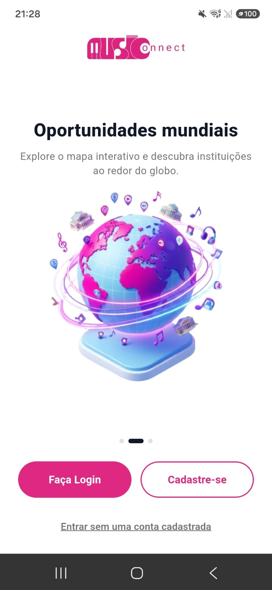<br><sub>Boas-vindas</sub></td>
    <td align="center">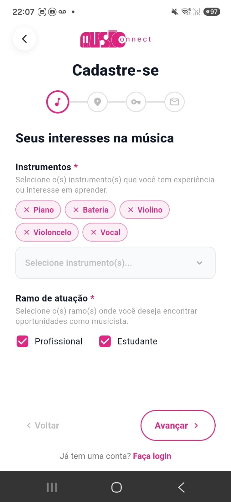<br><sub>Cadastro (etapa 1 de 4)</sub></td>
    <td align="center">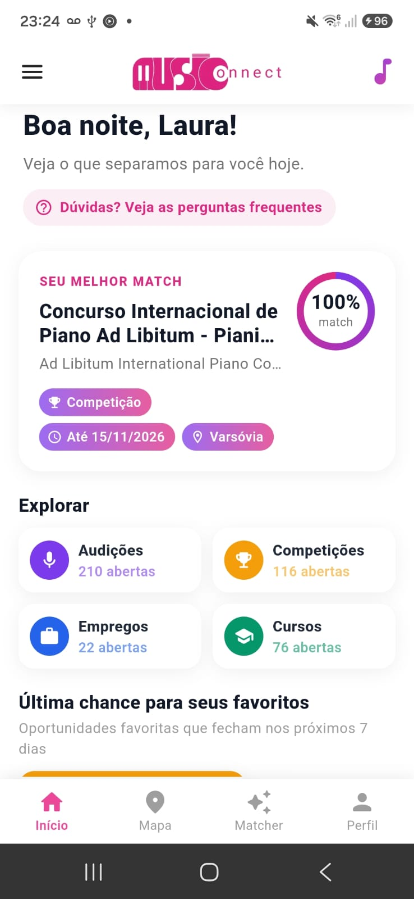<br><sub>Início</sub></td>
    <td align="center">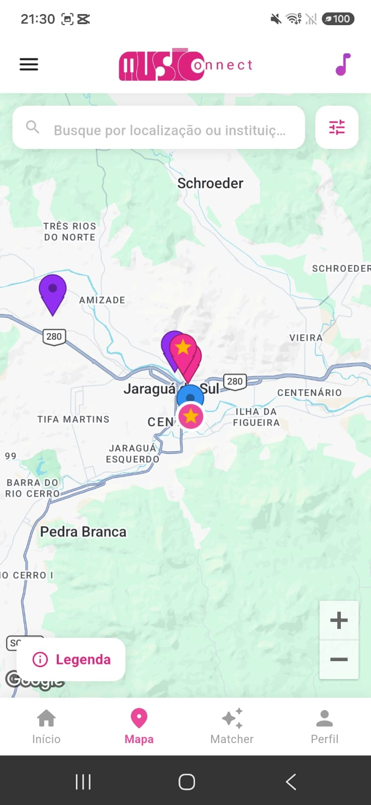<br><sub>Mapa</sub></td>
  </tr>
  <tr>
    <td align="center">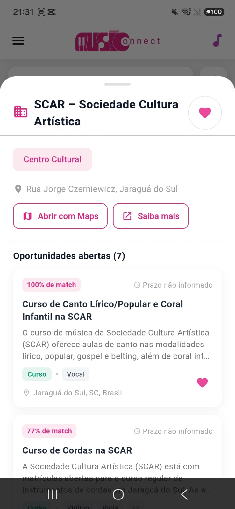<br><sub>Instituição no mapa</sub></td>
    <td align="center">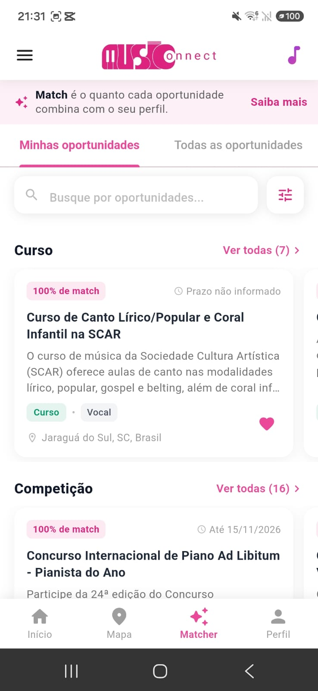<br><sub>Matcher</sub></td>
    <td align="center">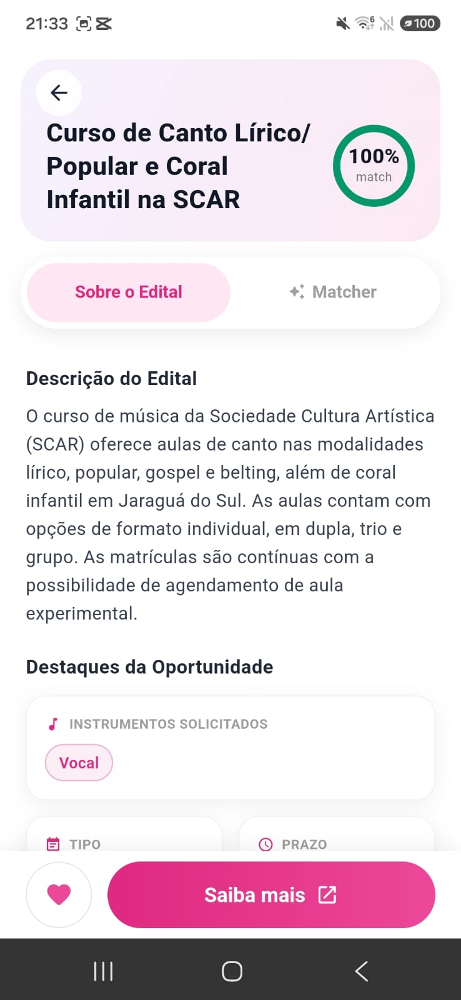<br><sub>Detalhe: Sobre o Edital</sub></td>
    <td align="center">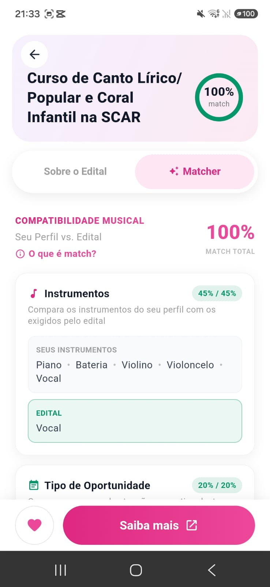<br><sub>Detalhe: Matcher</sub></td>
  </tr>
  <tr>
    <td align="center">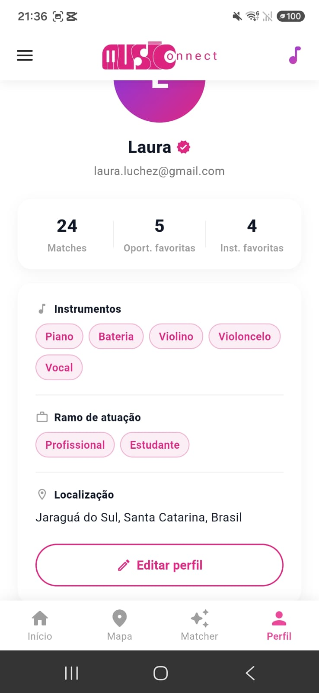<br><sub>Perfil</sub></td>
    <td align="center">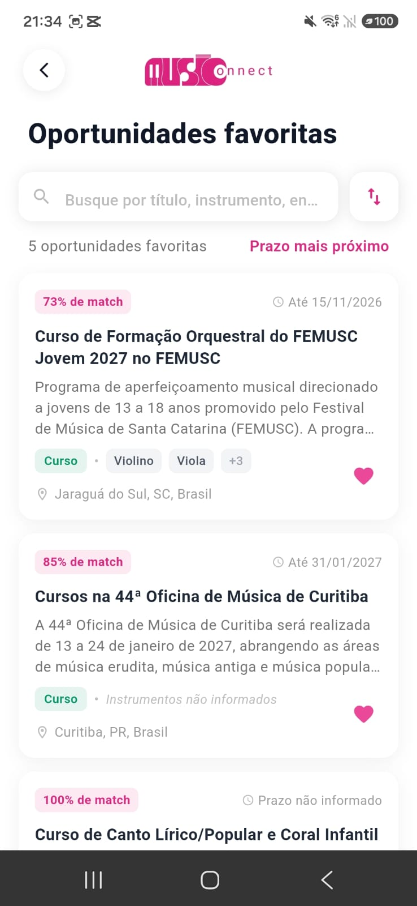<br><sub>Favoritos</sub></td>
    <td align="center">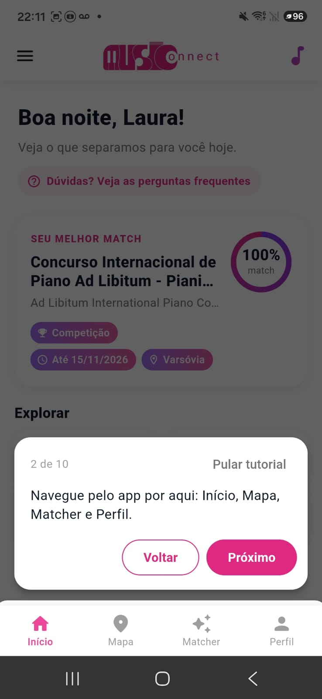<br><sub>Tutorial</sub></td>
    <td align="center">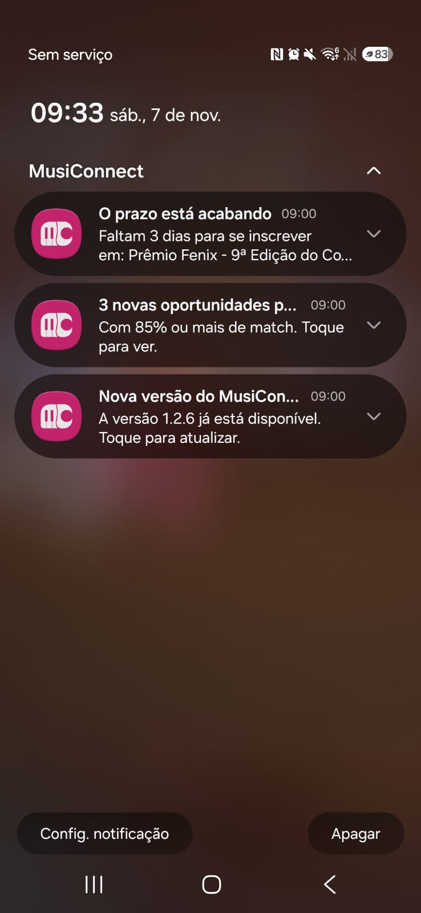<br><sub>Notificações</sub></td>
  </tr>
  <tr>
    <td align="center">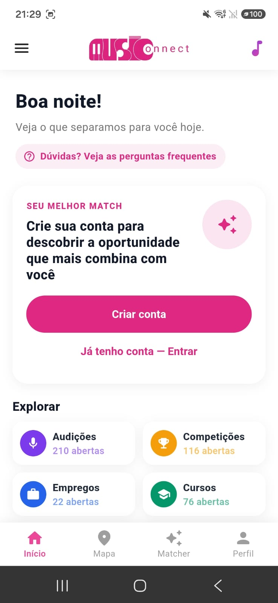<br><sub>Visitante: Início</sub></td>
    <td align="center">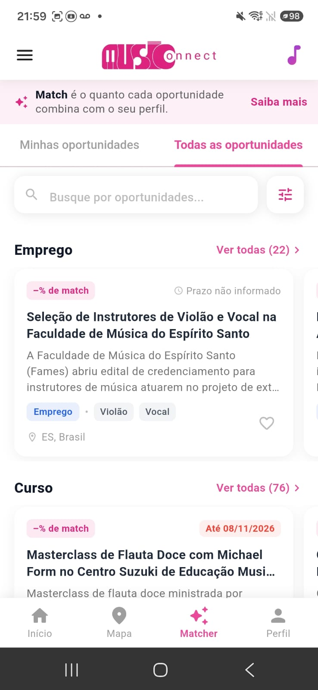<br><sub>Visitante: Matcher</sub></td>
    <td align="center">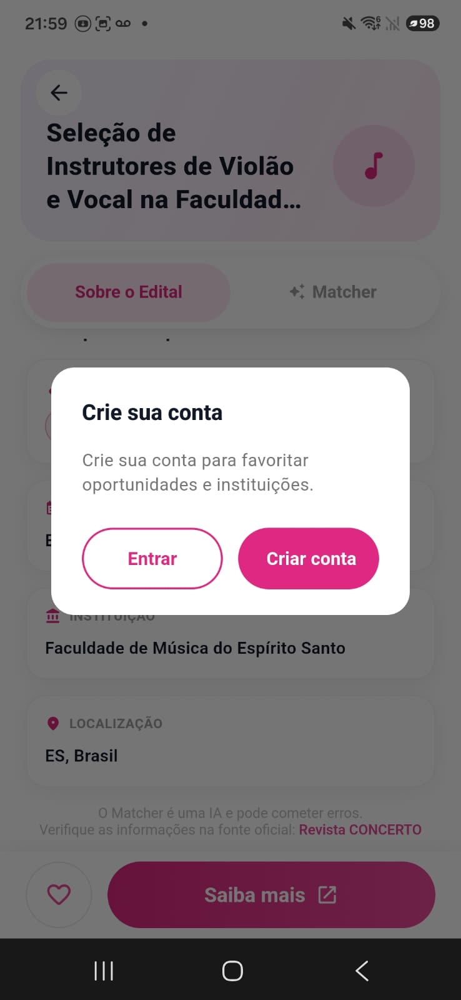<br><sub>Visitante: favoritar</sub></td>
    <td align="center">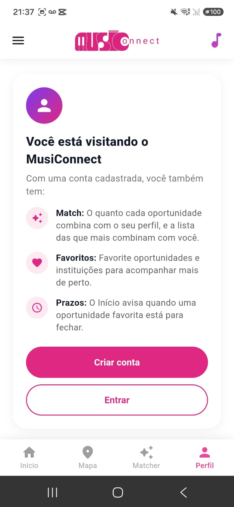<br><sub>Visitante: Perfil</sub></td>
  </tr>
</table>

*Capturas de tela: [docs/img/telas/](docs/img/telas/), organizadas em `comum/`, `cadastrado/` e `visitante/`.*

#### Cálculo do match

O percentual de compatibilidade corresponde à soma de quatro fatores, cada um com uma pontuação máxima:

| Fator | Máximo | Critério de pontuação |
|---|:---:|---|
| Instrumento | 45 | Proporção dos instrumentos exigidos pela oportunidade que constam no perfil do usuário. A oportunidade sem instrumento informado é considerada aberta a todos e recebe a pontuação máxima. |
| Ramo de atuação × tipo de oportunidade | 20 | Afinidade entre o ramo do usuário e o tipo da oportunidade: cursos valem 100% para estudantes e 60% para profissionais; empregos, 40% para estudantes e 100% para profissionais; audições e competições, 100% para ambos. Tipo não mapeado ou ramo não informado recebe 50%. |
| Localização | 20 | Mesma cidade ou oportunidade remota: 100%; mesmo estado: 60%; mesmo país: 30%; outro país: 0%. A oportunidade sem localização informada recebe 50%. |
| Confiança da extração | 15 | Nota de confiança atribuída pelo Gemini à interpretação do edital, de 0% a 100%, convertida proporcionalmente em pontos. Como só são exibidas oportunidades com confiança de pelo menos 80%, esse fator varia, na prática, entre 12 e 15 pontos. |

Cada fator é arredondado antes da soma, de modo que o detalhamento exibido no aplicativo corresponde exatamente ao total. Oportunidades com match a partir de 85% são consideradas de alta compatibilidade: aparecem em "Minhas oportunidades" e podem gerar notificações.

### 3.2 Diferencial e inovação

Na fase de proposta e idealização do projeto, foram analisadas três plataformas do mercado musical que se aproximam da proposta do MusiConnect:

- **Vampr:** aplicativo de networking que conecta músicos, produtores e profissionais da indústria musical, permitindo encontrar colaboradores, vagas remuneradas e oportunidades de carreira.
- **Muvac:** plataforma voltada a profissionais de música clássica e jazz, que centraliza candidaturas a audições, contatos profissionais e presença digital dos músicos.
- **Strm Music:** plataforma brasileira que utiliza IA e ciência de dados para oferecer diagnóstico de carreira, recomendações e adiantamento de royalties.

| Característica | Vampr | Muvac | Strm Music | MusiConnect |
|---|:---:|:---:|:---:|:---:|
| Gestão de carreira e oportunidades | ✅ | ✅ | ✅ | ✅ |
| Recomendação de oportunidades pelo perfil do músico | — | — | ✅ | ✅ |
| Foco em networking | ✅ | — | — | — |
| Oportunidades nacionais, profissionais e educacionais | ✅ | — | — | ✅ |
| Aplicativo mobile | ✅ | — | — | ✅ |
| Gratuito | ✅ | — | — | ✅ |
| Foco em estudantes | — | — | — | ✅ |

*Fonte: adaptado da análise comparativa do Relatório Final do PAC Extensionista VII (jun/2026).*

No entanto, nenhuma das plataformas analisadas reúne, em um único aplicativo gratuito e em português, a coleta automatizada de oportunidades, a recomendação baseada no perfil do músico e o mapa de instituições musicais — lacuna que o MusiConnect já preenche. Nesse sentido, o diferencial do projeto consolida-se nos seguintes pontos:

- **Curadoria ativa e automatizada:** em vez de exigir buscas manuais em portais dispersos, o sistema coleta diariamente oportunidades de fontes nacionais e internacionais e as apresenta ao usuário.
- **Acessibilidade cognitiva por meio de IA:** editais extensos, frequentemente redigidos em outros idiomas, são convertidos em resumos objetivos em português, com os dados essenciais (tipo, instrumentos, localização e prazo) destacados.
- **Match explicável:** além do percentual de compatibilidade (Match), o aplicativo mostra quanto cada fator contribuiu para o resultado, permitindo que o usuário compreenda porquê uma oportunidade foi recomendada ou não.
- **Integração entre oportunidades e território:** o mapa relaciona as oportunidades às instituições e às cidades onde ocorrem, facilitando a exploração de novos polos artísticos.
- **Acesso gratuito e inclusivo:** o modelo gratuito, sem anúncios, e o modo visitante ampliam o alcance da ferramenta para além da SCAR, em consonância com o propósito de reduzir a evasão de talentos e ampliar a permanência de estudantes e profissionais na carreira musical.

---

## 4. Vídeo da aplicação

> 🚧 Em construção — o vídeo de demonstração do app final entra aqui.

Pitch de apresentação da proposta (PAC Extensionista VII, jun/2026): [MusiConnect – Sua motivação para seguir a carreira da música](https://youtu.be/iI1wommzjRY)

---

## 5. Requisitos

Os requisitos a seguir descrevem o sistema entregue. Para diferenciá-los da proposta original, utilizam a numeração RF01, RF02... e RNF01, RNF02...; a correspondência com os requisitos do RFC (RF.1 a RF.10 e RNF.1 a RNF.7) é apresentada na seção [5.3](#53-rastreabilidade-com-o-rfc).

### 5.1 Requisitos funcionais

**Conta e acesso**

| Código | Requisito |
|---|---|
| RF01 | Permitir o cadastro do usuário em quatro etapas — interesses musicais (instrumentos e ramo de atuação), localização, credenciais (nome, e-mail e senha) e confirmação do e-mail —, com aceite obrigatório da política de privacidade. |
| RF02 | Confirmar o e-mail do usuário por meio de um link válido por 24 horas, com opção de reenvio. |
| RF03 | Autenticar o usuário com e-mail e senha, impedindo o acesso de contas com e-mail não confirmado. |
| RF04 | Permitir a redefinição de senha por meio de um link enviado por e-mail, válido por 15 minutos. |
| RF05 | Permitir o uso do aplicativo sem cadastro (modo visitante), mediante aceite da política de privacidade, com sessão encerrada ao fechar o aplicativo. |
| RF06 | Permitir a edição do perfil: nome, instrumentos, ramo de atuação (estudante e/ou profissional) e localização (país, estado e cidade). |
| RF07 | Permitir a alteração da senha, mediante informação da senha atual. |
| RF08 | Permitir a exclusão da conta e de todos os dados associados, mediante confirmação da senha. |
| RF09 | Permitir o encerramento da sessão no dispositivo. |

**Oportunidades e match**

| Código | Requisito |
|---|---|
| RF10 | Coletar diariamente, de forma automatizada, oportunidades musicais de fontes especializadas (Musical Chairs, WFIMC, Revista CONCERTO, SCAR e FEMUSC). |
| RF11 | Interpretar cada edital com Inteligência Artificial, extraindo tipo, instrumentos, localização, modalidade e prazo, gerando um resumo em português e atribuindo uma nota de confiança à extração. |
| RF12 | Ocultar automaticamente as oportunidades que não correspondem a chamadas abertas, que não envolvem participação ativa (tocar, cantar, reger ou compor), cujo prazo expirou, cujo edital foi retirado da fonte ou cuja confiança é inferior a 80%. |
| RF13 | Calcular o percentual de compatibilidade (match) entre o perfil do usuário e cada oportunidade, com o detalhamento da pontuação de cada fator. |
| RF14 | Listar as oportunidades em duas abas — de alta compatibilidade (match a partir de 85%) e todas —, agrupadas por tipo, com busca e filtros por tipo, instrumento, localização, instrumento do perfil, proximidade e escala de match. |
| RF15 | Exibir o detalhe de cada oportunidade: resumo, destaques, conteúdo original, comparação com o perfil do usuário e link para o edital original. |
| RF16 | Apresentar, na tela inicial, a oportunidade de maior compatibilidade, a quantidade de oportunidades abertas por tipo e as oportunidades favoritas com menos de 7 dias até o encerramento do prazo. |

**Mapa de instituições**

| Código | Requisito |
|---|---|
| RF17 | Exibir, em mapa de escala global, as instituições musicais do OpenStreetMap, com marcadores coloridos por categoria e destaque para as instituições com oportunidades abertas. |
| RF18 | Permitir a busca de instituições e localidades no mapa, a filtragem por categoria e por instituições com oportunidades abertas, e a consulta da legenda. |
| RF19 | Exibir o detalhe de cada instituição: categoria, endereço, site e e-mail (quando disponíveis), atalho para o aplicativo de mapas e oportunidades abertas. |
| RF20 | Agrupar, em marcadores posicionados no centro de cada cidade, as oportunidades cuja instituição não possui endereço exato. |

**Favoritos, notificações e apoio ao usuário**

| Código | Requisito |
|---|---|
| RF21 | Permitir favoritar oportunidades e instituições, com listas próprias, busca e ordenação, removendo automaticamente as oportunidades favoritas que deixam de estar disponíveis. |
| RF22 | Enviar notificações, mediante autorização do usuário, sobre novas oportunidades com match a partir de 85%, oportunidades favoritas com prazo próximo do encerramento e novas versões do aplicativo, permitindo ativar ou desativar cada tipo no perfil. |
| RF23 | Oferecer um tutorial guiado no primeiro acesso, que pode ser revisto a qualquer momento na página de ajuda. |
| RF24 | Disponibilizar uma página de ajuda com perguntas frequentes e canal de contato por e-mail. |
| RF25 | Exibir a política de privacidade e solicitar novo aceite sempre que a sua versão for alterada. |
| RF26 | Permitir que o usuário desative o envio de dados de uso e de erros. |

### 5.2 Requisitos não funcionais

| Código | Categoria | Requisito |
|---|---|---|
| RNF01 | Plataforma | O aplicativo deve ser desenvolvido em Flutter e distribuído para Android 6.0 ou superior (API 23), compilado para a API 36. |
| RNF02 | Arquitetura | O aplicativo deve seguir o padrão MVVM (View → ViewModel → serviços), e o backend deve ser uma API REST em FastAPI (Python 3.12), com a coleta e a interpretação dos editais executadas em segundo plano, sem bloquear as requisições do aplicativo. |
| RNF03 | Persistência | Os dados devem ser armazenados em PostgreSQL 16 com a extensão PostGIS, com índice espacial para as consultas geográficas do mapa. |
| RNF04 | Integração | As instituições devem ser obtidas do OpenStreetMap por meio do QLever (SPARQL), e a interpretação dos editais deve utilizar o modelo Gemini, operando dentro da cota gratuita, com troca automática para um modelo alternativo quando a cota se esgota e reprocessamento apenas dos editais cujo texto foi alterado. |
| RNF05 | Segurança | A comunicação deve ocorrer exclusivamente por HTTPS; as senhas devem ser armazenadas com hash bcrypt e seguir uma política mínima (8 caracteres e ao menos dois critérios entre letras maiúsculas e minúsculas, números e caracteres especiais); os tokens de sessão devem ser aleatórios e invalidados no encerramento da sessão ou na troca de senha; as rotas administrativas devem exigir chave de acesso; e o servidor deve contar com firewall e bloqueio de tentativas de acesso indevido. |
| RNF06 | Privacidade | O tratamento de dados deve observar a LGPD: consentimento explícito e versionado, coleta mínima, exclusão integral da conta, dados de uso pseudonimizados e opcionais e ausência de identificador de publicidade. |
| RNF07 | Qualidade | O código deve passar por integração contínua a cada envio ao repositório (testes automatizados do backend e do aplicativo) e por análise estática no SonarCloud, com Quality Gate aprovado. |
| RNF08 | Entrega | A API deve ser implantada automaticamente após a aprovação do pipeline, e cada nova versão do aplicativo deve gerar um APK assinado, publicado para download. |
| RNF09 | Observabilidade | O aplicativo deve registrar métricas de uso (Firebase Analytics) e falhas (Firebase Crashlytics), e a disponibilidade da API e do site deve ser monitorada a cada 5 minutos, com alerta por e-mail. |
| RNF10 | Disponibilidade | Os serviços devem ser executados em contêineres Docker, com backup diário do banco de dados retido por 14 dias. |
| RNF11 | Usabilidade | A interface deve estar em português, adaptar-se a diferentes tamanhos de tela e fornecer retorno ao usuário em ações relevantes (carregamento, erros e confirmações). |
| RNF12 | Acessibilidade financeira | O uso do aplicativo deve ser gratuito e sem anúncios. |

### 5.3 Rastreabilidade com o RFC

A tabela a seguir relaciona os requisitos da proposta original (Relatório Final do PAC Extensionista VII) aos requisitos do sistema entregue. As alterações são justificadas na seção [13. Decisões técnicas](#13-decisões-técnicas-e-mudanças-em-relação-ao-rfc).

| RFC | Descrição resumida | Sistema entregue | Situação |
|---|---|---|---|
| RF.1 | Cadastro e login | RF01–RF04 | ✅ Atendido |
| RF.2 | Competências: instrumento, nível técnico, repertório e objetivos de carreira | RF06 | ⚠️ Parcial: instrumento, ramo de atuação e localização; nível técnico e objetivos de carreira não incluídos, porque a maioria dos editais não informa o nível exigido nem permite relacioná-lo a objetivos de carreira — no match, esses critérios resultariam majoritariamente em "Não informado" e não diferenciariam as oportunidades |
| RF.3 | Cadastro de repertório | — | ❌ Não implementado, porque os editais raramente especificam o repertório exigido, o que impediria a comparação com o repertório do músico; o cadastro exigiria esforço do usuário sem melhorar a recomendação |
| RF.4 | Busca contínua de editais | RF10 | ✅ Atendido |
| RF.5 | Resumos simplificados dos editais | RF11 | ✅ Atendido |
| RF.6 | Feed de oportunidades personalizado | RF13, RF14 | ✅ Atendido (match por regras) |
| RF.7 | Notificação de oportunidades compatíveis | RF22 | ✅ Atendido |
| RF.8 | Mapa interativo de instituições | RF17–RF20 | ✅ Atendido |
| RF.9 | Interface com atenção à experiência do usuário | RF23, RNF11 | ✅ Atendido |
| RF.10 | Uso gratuito | RNF12 | ✅ Atendido |
| RNF.1 | Instituições do OpenStreetMap via Overpass API | RNF04 | 🔄 Alterado: QLever no lugar do Overpass, porque o serviço público do Overpass excedia o tempo limite em regiões extensas (o Brasil inteiro chegou a ficar de fora), limitava os resultados por consulta e retornava listas vazias sem indicar erro, o que restringia a base a cerca de 16 mil instituições; com o QLever, que permite consultas SPARQL paginadas sobre uma cópia completa do OpenStreetMap, a base passou a mais de 82 mil instituições |
| RNF.2 | PostgreSQL com PostGIS e pgvector | RNF03 | ⚠️ Parcial: PostGIS adotado; pgvector não utilizado, porque a interpretação passou a ser feita por extração direta com o Gemini, sem RAG — como os editais são textos curtos, não há necessidade de busca semântica por *embeddings* |
| RNF.3 | Flutter com Clean Architecture | RNF01, RNF02 | 🔄 Alterado: MVVM no lugar da Clean Architecture, porque é a arquitetura recomendada pela documentação oficial do Flutter e mantém a separação entre interface, estado e dados; a camada de casos de uso da Clean Architecture seria redundante, já que as regras de negócio (match, filtragem e interpretação dos editais) ficam no backend |
| RNF.4 | FastAPI com processamento assíncrono | RNF02 | ✅ Atendido |
| RNF.5 | SonarCloud | RNF07 | ✅ Atendido |
| RNF.6 | Firebase Analytics | RNF09 | ✅ Atendido |
| RNF.7 | APK instalável ou Google Play | RNF08 | ✅ Atendido por APK; publicação no Google Play em andamento |

Os requisitos RF05, RF08, RF12, RF20, RF21 e RF23 a RF26, bem como RNF05, RNF06, RNF08 e RNF10, não constavam no RFC: surgiram durante o desenvolvimento, a partir da validação com a SCAR e das exigências de segurança, privacidade e publicação do aplicativo.

---

## 6. Casos de uso

### 6.1 Atores

**Atores humanos**

- **Qualquer usuário (visitante ou cadastrado):** ator abstrato que reúne as ações disponíveis a qualquer pessoa que utiliza o aplicativo, com ou sem conta. Nos diagramas, a seta de generalização (ponta triangular vazada) indica que o visitante e o usuário cadastrado herdam todos os casos de uso desse ator.
- **Visitante:** utiliza o aplicativo sem cadastro e pode criar uma conta.
- **Usuário cadastrado:** possui conta e tem acesso, além das ações comuns, ao match, aos favoritos, ao perfil e às notificações.

**Atores de sistema**

- **Agendador:** componente do backend que inicia, diariamente, a atualização das instituições do mapa (00h), a coleta de oportunidades (06h) e o envio de notificações (09h).
- **Fontes de oportunidades:** sites de onde os editais são coletados (Musical Chairs, WFIMC, Revista CONCERTO, SCAR e FEMUSC).
- **Gemini:** modelo de linguagem que interpreta os editais coletados.
- **OpenStreetMap (QLever):** base de dados geográfica que fornece as instituições musicais.
- **Firebase:** serviço que entrega as notificações aos dispositivos.
- **Resend:** serviço que envia os e-mails de confirmação de cadastro e de redefinição de senha.

### 6.2 Diagramas de casos de uso

Para facilitar a leitura, os casos de uso foram divididos em três diagramas, conforme o grupo de atores envolvido.

>**OBS:** Nos diagramas, a seta que parte de um ator em direção a um caso de uso indica quem o inicia; a seta que parte de um caso de uso em direção a um ator de sistema indica um serviço externo acionado durante a sua execução (por exemplo, o envio de e-mail pelo Resend ao criar a conta). As relações «include» indicam uma etapa sempre executada, e «extend», uma etapa executada apenas em determinada condição.

<table>
  <tr>
    <td align="center">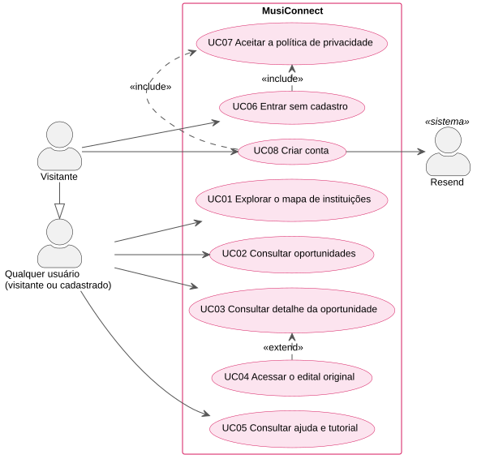<br><sub>(a) Usuário e visitante</sub></td>
    <td align="center">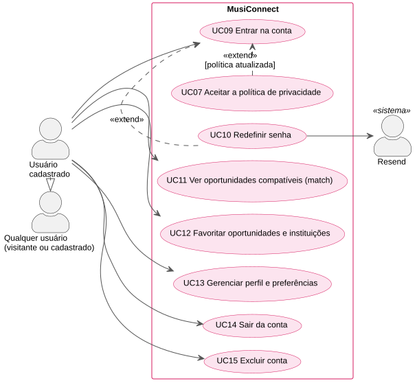<br><sub>(b) Usuário cadastrado</sub></td>
  </tr>
  <tr>
    <td align="center" colspan="2">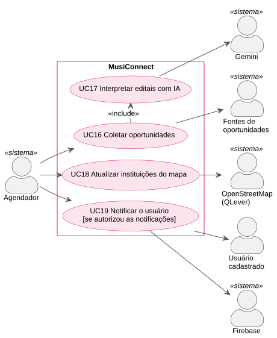<br><sub>(c) Processos automáticos do sistema</sub></td>
  </tr>
</table>

*Fonte: elaborado pela autora (2026), com PlantUML. Código-fonte dos diagramas: [docs/diagramas/casos-de-uso.puml](docs/diagramas/casos-de-uso.puml).*

### 6.3 Descrição dos casos de uso

| Código | Caso de uso | Ator principal | Atores secundários | Requisitos |
|---|---|---|---|---|
| UC01 | Explorar o mapa de instituições | Qualquer usuário | — | RF17–RF20 |
| UC02 | Consultar oportunidades | Qualquer usuário | — | RF14 |
| UC03 | Consultar detalhe da oportunidade | Qualquer usuário | — | RF15 |
| UC04 | Acessar o edital original (estende UC03) | Qualquer usuário | — | RF15 |
| UC05 | Consultar ajuda e tutorial | Qualquer usuário | — | RF23, RF24 |
| UC06 | Entrar sem cadastro | Visitante | — | RF05 |
| UC07 | Aceitar a política de privacidade (incluído em UC06 e UC08; estende UC09 quando a política é atualizada) | Visitante, Usuário cadastrado | — | RF01, RF05, RF25 |
| UC08 | Criar conta | Visitante | Resend | RF01, RF02 |
| UC09 | Entrar na conta | Usuário cadastrado | — | RF03 |
| UC10 | Redefinir senha (estende UC09) | Usuário cadastrado | Resend | RF04 |
| UC11 | Ver oportunidades compatíveis (match) | Usuário cadastrado | — | RF13, RF14, RF16 |
| UC12 | Favoritar oportunidades e instituições | Usuário cadastrado | — | RF21 |
| UC13 | Gerenciar perfil e preferências (inclui autorizar e configurar as notificações) | Usuário cadastrado | — | RF06, RF07, RF22, RF26 |
| UC14 | Sair da conta | Usuário cadastrado | — | RF09 |
| UC15 | Excluir conta | Usuário cadastrado | — | RF08 |
| UC16 | Coletar oportunidades | Agendador | Fontes de oportunidades | RF10, RF12 |
| UC17 | Interpretar editais com IA (incluído em UC16) | Agendador | Gemini | RF11, RF12 |
| UC18 | Atualizar instituições do mapa | Agendador | OpenStreetMap (QLever) | RF17 |
| UC19 | Notificar o usuário (pré-condição: notificações autorizadas pelo usuário em UC13) | Agendador | Firebase, Usuário cadastrado | RF22 |

---

## 7. Fluxos de uso

Os três fluxos a seguir percorrem o aplicativo de ponta a ponta e demonstram o seu valor: o primeiro acesso, a descoberta e o acompanhamento de uma oportunidade compatível e a exploração das instituições no mapa. Cada fluxo é apresentado com a sequência de telas correspondente e um link para o seu diagrama de atividade.

### 7.1 Fluxo 1: Cadastro e primeiro acesso

**Objetivo:** criar uma conta e chegar à tela inicial com uma recomendação personalizada.

**Ator:** visitante, que passa a usuário cadastrado. | **Casos de uso envolvidos:** UC06, UC07, UC08, UC09, UC05 e UC13.

O diagrama de atividade deste fluxo está em [docs/diagramas/fluxos-de-uso.md](docs/diagramas/fluxos-de-uso.md#71-fluxo-1-cadastro-e-primeiro-acesso).

<table>
  <tr>
    <td align="center"><br><sub>1. Boas-vindas</sub></td>
    <td align="center"><br><sub>2. Interesses</sub></td>
    <td align="center">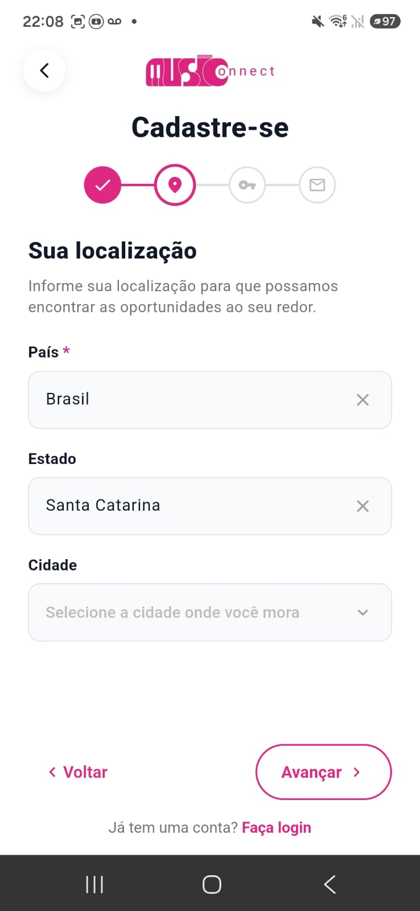<br><sub>3. Localização</sub></td>
    <td align="center">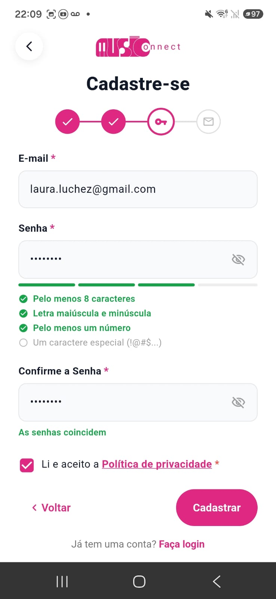<br><sub>4. Credenciais e política</sub></td>
  </tr>
  <tr>
    <td align="center">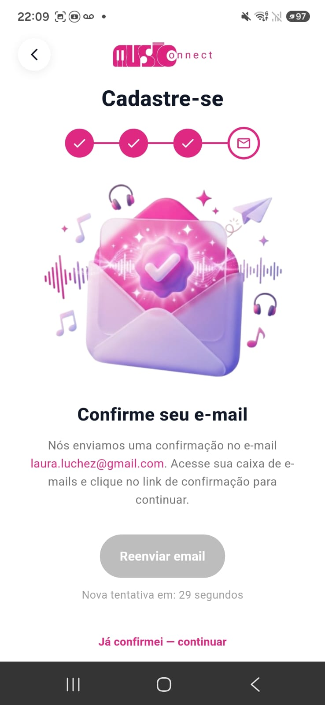<br><sub>5. Confirme seu e-mail</sub></td>
    <td align="center">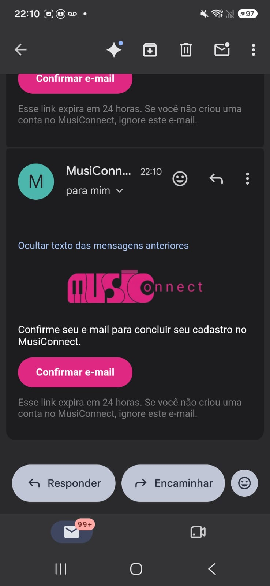<br><sub>6. E-mail recebido</sub></td>
    <td align="center">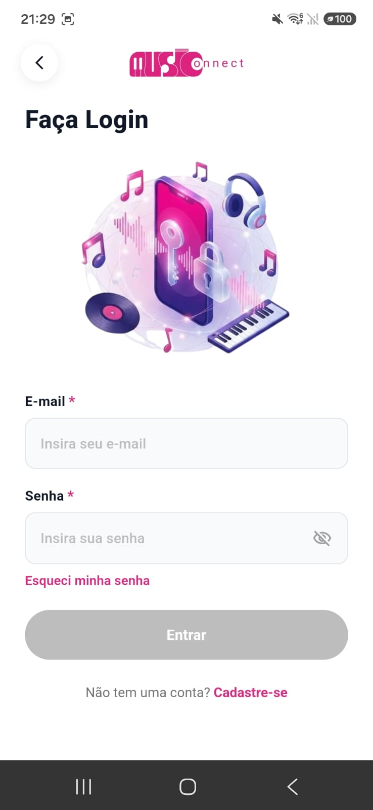<br><sub>7. Login</sub></td>
    <td align="center">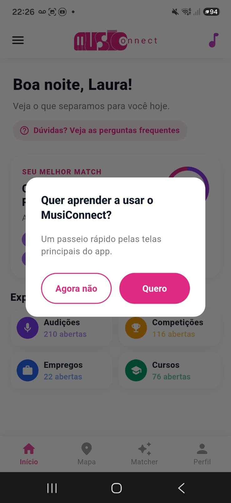<br><sub>8. Convite do tutorial</sub></td>
  </tr>
  <tr>
    <td align="center">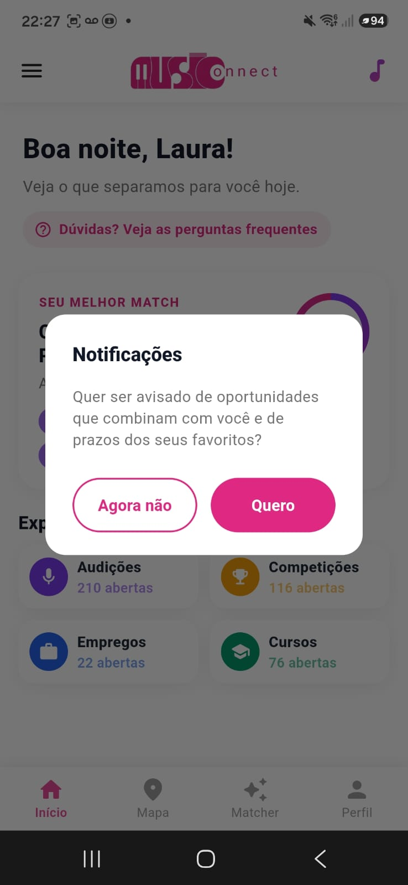<br><sub>9. Convite das notificações</sub></td>
    <td align="center">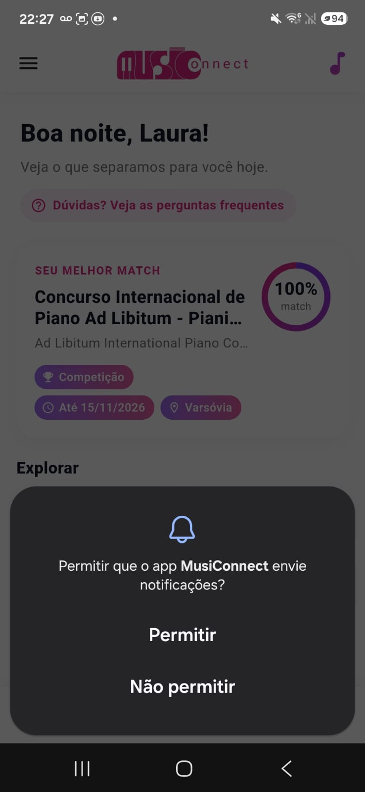<br><sub>10. Permissão do Android</sub></td>
    <td align="center"><br><sub>11. Início</sub></td>
    <td></td>
  </tr>
</table>

### 7.2 Fluxo 2: Encontrar e acompanhar uma oportunidade compatível

**Objetivo:** identificar uma oportunidade compatível com o perfil, compreender os seus requisitos e acompanhar o prazo até a inscrição.

**Ator:** usuário cadastrado. | **Casos de uso envolvidos:** UC11, UC03, UC12, UC19 e UC04.

O diagrama de atividade deste fluxo está em [docs/diagramas/fluxos-de-uso.md](docs/diagramas/fluxos-de-uso.md#72-fluxo-2-encontrar-e-acompanhar-uma-oportunidade-compatível).

<table>
  <tr>
    <td align="center"><br><sub>1. Minhas oportunidades</sub></td>
    <td align="center">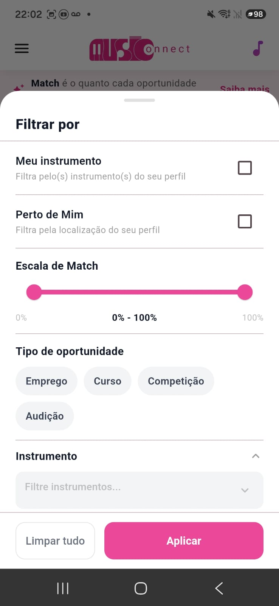<br><sub>2. Filtros</sub></td>
    <td align="center"><br><sub>3. Sobre o Edital</sub></td>
    <td align="center"><br><sub>4. Detalhamento do match</sub></td>
  </tr>
  <tr>
    <td align="center"><br><sub>5. Favoritos</sub></td>
    <td align="center"><br><sub>6. Notificação de prazo</sub></td>
    <td align="center">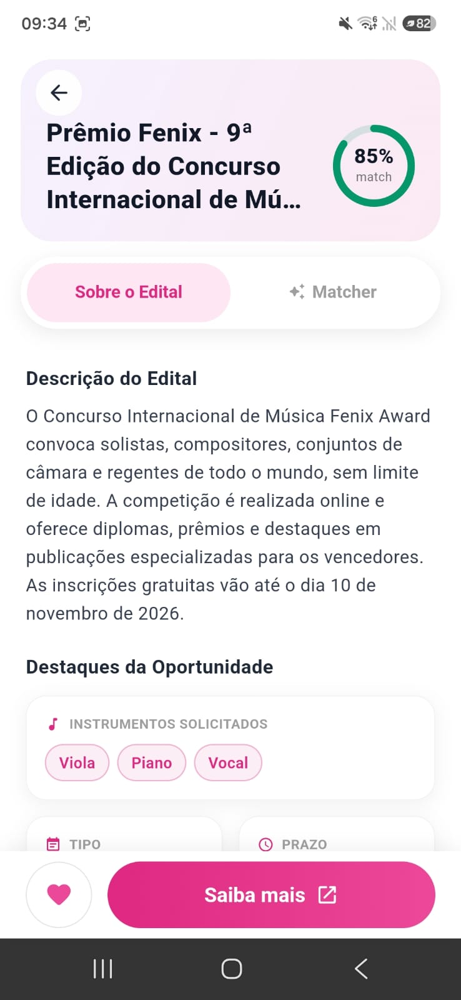<br><sub>7. Detalhe aberto pela notificação</sub></td>
    <td align="center">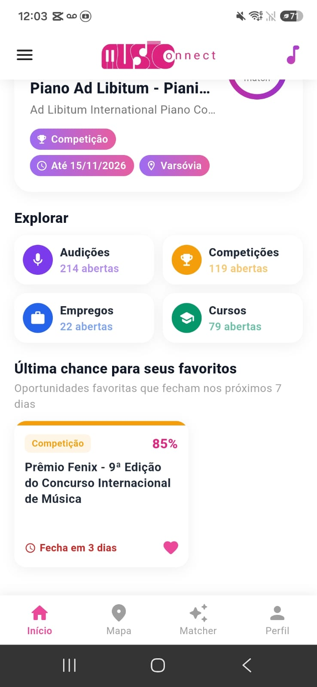<br><sub>8. Última chance (alternativa)</sub></td>
  </tr>
</table>

### 7.3 Fluxo 3: Explorar instituições no mapa

**Objetivo:** localizar instituições musicais e as oportunidades vinculadas a elas.

**Ator:** qualquer usuário (visitante ou cadastrado). | **Casos de uso envolvidos:** UC01, UC03 e UC12.

O diagrama de atividade deste fluxo está em [docs/diagramas/fluxos-de-uso.md](docs/diagramas/fluxos-de-uso.md#73-fluxo-3-explorar-instituições-no-mapa).

<table>
  <tr>
    <td align="center"><br><sub>1. Mapa</sub></td>
    <td align="center">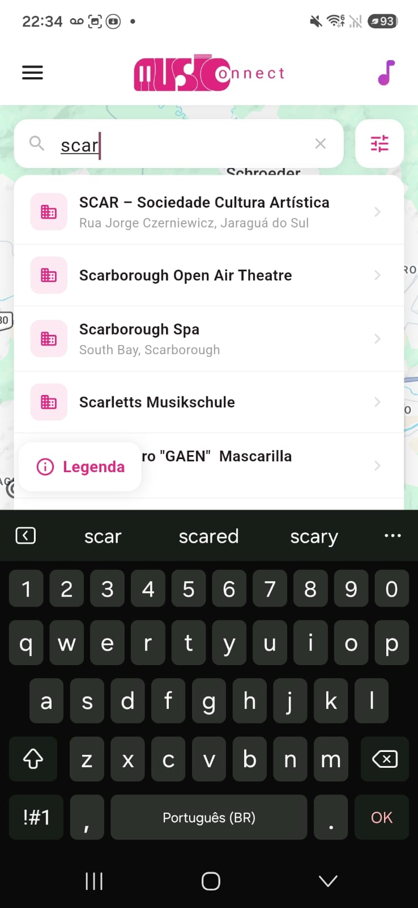<br><sub>2. Busca</sub></td>
    <td align="center">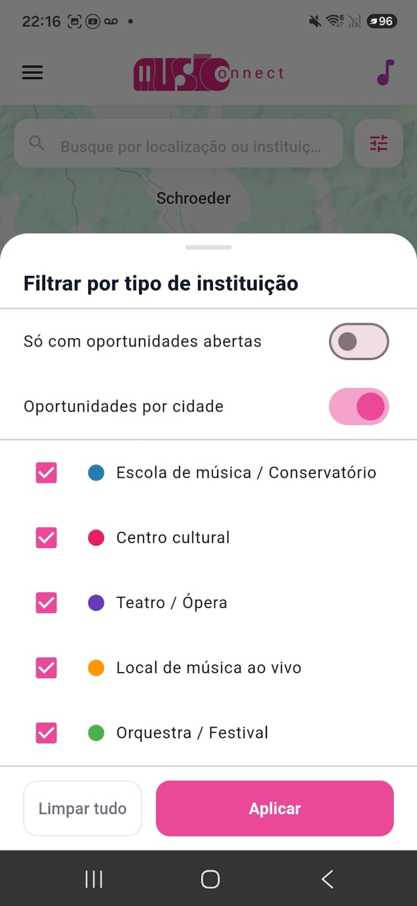<br><sub>3. Filtros</sub></td>
    <td align="center">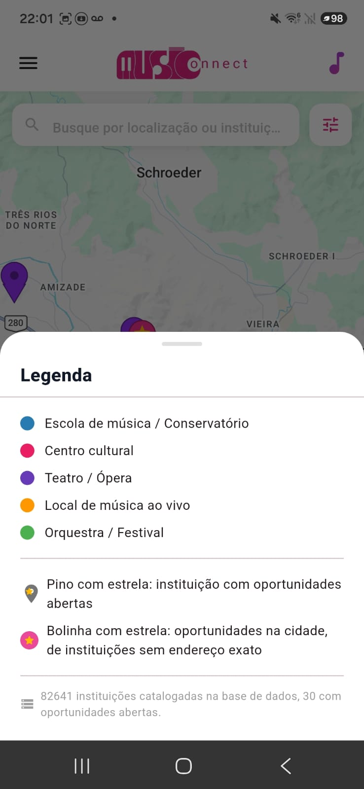<br><sub>4. Legenda</sub></td>
  </tr>
  <tr>
    <td align="center"><br><sub>5. Instituição</sub></td>
    <td align="center">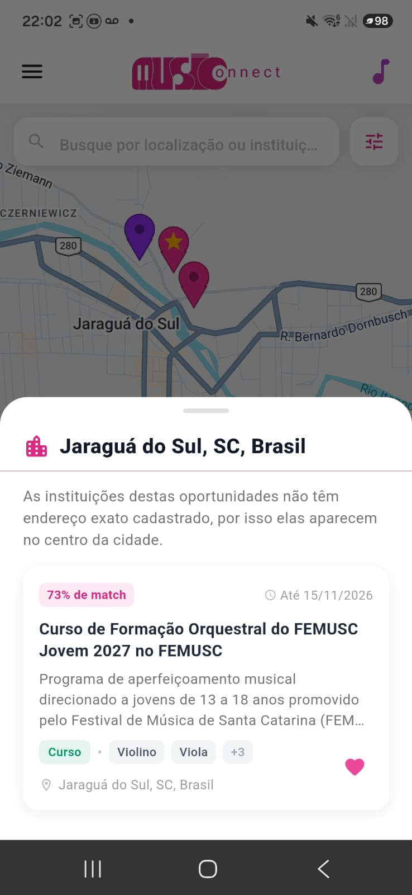<br><sub>6. Marcador de cidade</sub></td>
    <td align="center">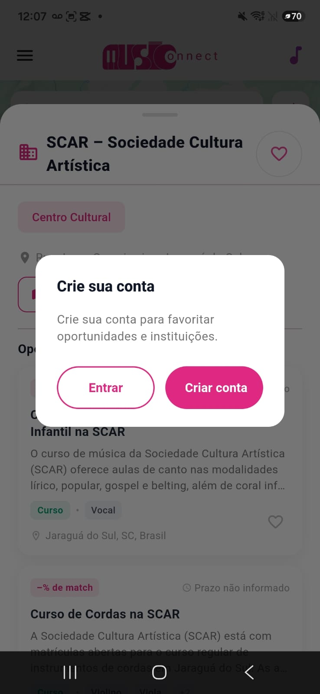<br><sub>7. Convite (visitante)</sub></td>
    <td align="center">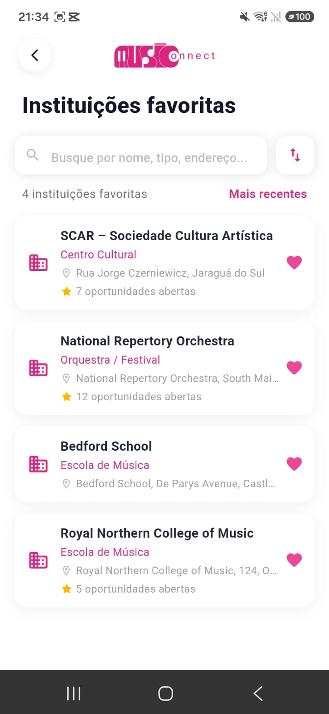<br><sub>8. Instituições favoritas</sub></td>
  </tr>
</table>

---

## 8. Estrutura de navegação

### 8.1 Padrões de navegação

A navegação do aplicativo combina cinco padrões:

- **Barra de navegação inferior:** quatro abas principais — Início, Mapa, Matcher e Perfil —, sempre visíveis após o acesso.
- **Menu lateral (☰):** atalhos para as oportunidades e instituições favoritas, a política de privacidade, a ajuda e suporte, e a saída da conta - para o visitante, a saída é substituída por "Voltar ao menu inicial".
- **Telas empilhadas/secundárias:** detalhe da oportunidade, listas por tipo de oportunidade, favoritos, edição de perfil e telas de apoio abrem sobre a tela atual e retornam pelo botão "voltar".
- **Painéis inferiores e janelas:** no mapa, a instituição, a cidade, os filtros e a legenda abrem em painéis deslizantes; confirmações, convites e avisos abrem em janelas sobre a tela (pop-up).
- **Entradas externas:** os links enviados por e-mail (confirmação de cadastro e redefinição de senha) e as notificações abrem o aplicativo diretamente na tela correspondente.

### 8.2 Mapa de navegação

O mapa completo, com todas as telas do aplicativo agrupadas em acesso, barra de navegação inferior, menu lateral, telas de detalhe e entradas externas, e os caminhos entre elas, está em [docs/diagramas/mapa-de-navegacao.md](docs/diagramas/mapa-de-navegacao.md).

No modo visitante, a navegação é a mesma, com três diferenças: a aba Perfil exibe um convite para criar conta ou entrar; as listas de favoritos e a aba "Minhas oportunidades" exibem o mesmo convite; e as ações que dependem de conta, como favoritar, abrem uma janela que encaminha ao cadastro ou ao login.

### 8.3 Elementos de navegação

<table>
  <tr>
    <td align="center"><br><sub>Barra inferior (abas)</sub></td>
    <td align="center">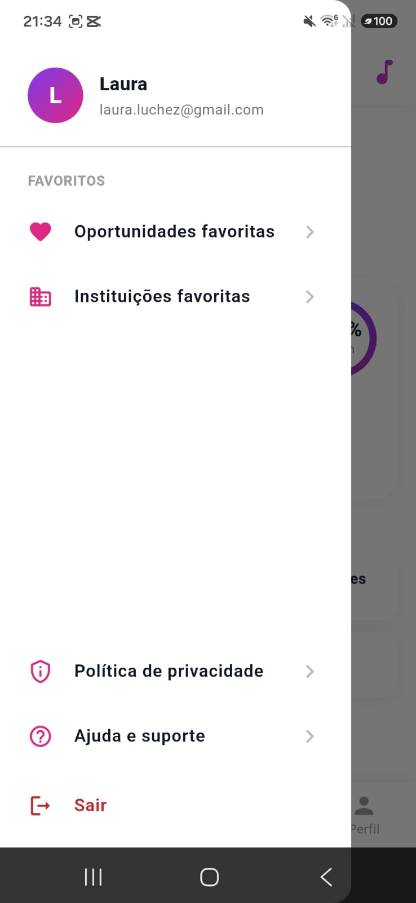<br><sub>Menu lateral (cadastrado)</sub></td>
    <td align="center">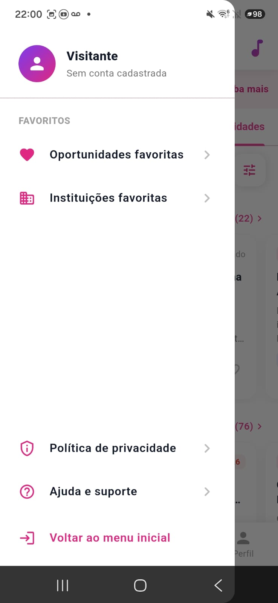<br><sub>Menu lateral (visitante)</sub></td>
    <td align="center">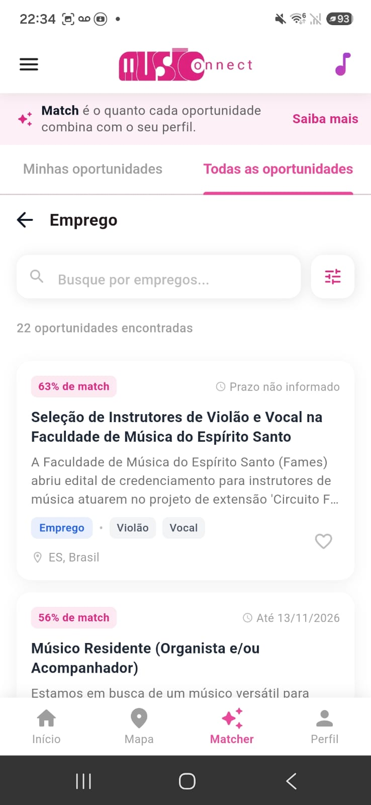<br><sub>Lista por tipo ("Ver todas")</sub></td>
  </tr>
  <tr>
    <td align="center"><br><sub>Painel inferior (mapa)</sub></td>
    <td align="center">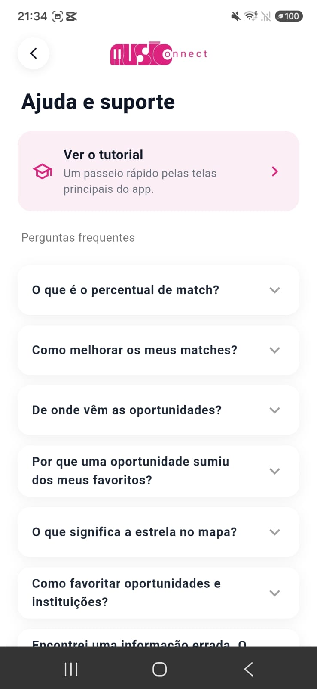<br><sub>Ajuda e suporte</sub></td>
    <td align="center">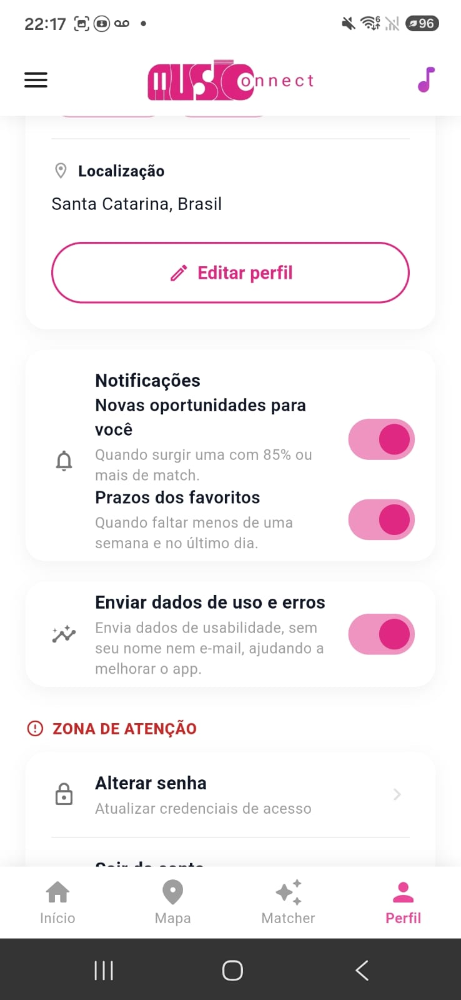<br><sub>Perfil: configurações</sub></td>
    <td align="center">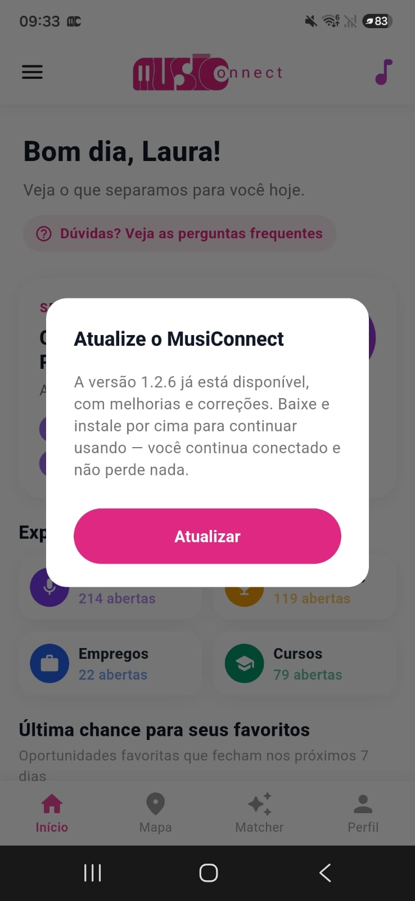<br><sub>Pop-up de nova versão</sub></td>
  </tr>
</table>

---

## 9. Arquitetura

O MusiConnect adota uma arquitetura cliente-servidor: um aplicativo Android em Flutter consome uma API REST em FastAPI, que concentra as regras de negócio, o cálculo do match e o pipeline de dados (coleta, interpretação por IA e atualização do mapa). A arquitetura é descrita a seguir pelo modelo C4, nos níveis de contexto e de contêineres, complementado pela arquitetura interna do aplicativo, pela modelagem de dados e pelo pipeline de dados.

### 9.1 Visão geral (modelo C4)

#### Nível 1: Contexto

O diagrama de contexto apresenta o sistema como um todo, as pessoas que o utilizam e os sistemas externos com os quais se comunica.

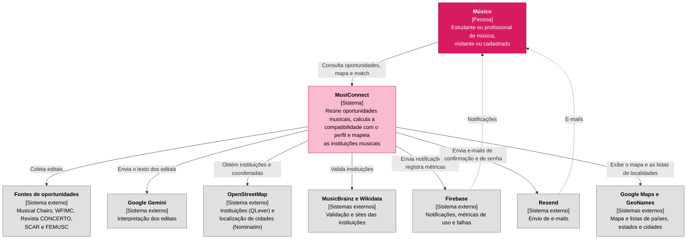

#### Nível 2: Contêineres

O diagrama de contêineres detalha as unidades executáveis do sistema e a comunicação entre elas. Em produção, o banco de dados, a API e o servidor web são executados em contêineres Docker, orquestrados pelo Docker Compose em um servidor virtual privado (VPS) da Hostinger.

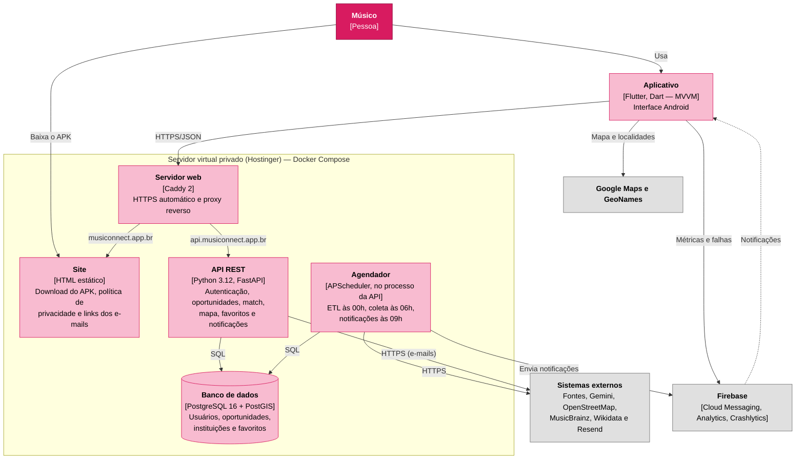

### 9.2 Arquitetura do aplicativo (MVVM)

O aplicativo segue o padrão **MVVM (Model-View-ViewModel)**, arquitetura recomendada pela documentação oficial do Flutter. Cada camada tem uma responsabilidade:

- **View (`presentation/screens` e `presentation/widgets`):** telas e componentes visuais, exibindo o estado e repassando as ações do usuário ao ViewModel, sem lógica de negócio.
- **ViewModel (`presentation/view_models`):** guarda o estado de cada tela (carregamento, dados, erros e filtros) e coordena as chamadas aos serviços, herdando de uma classe base `ViewModel` (um `ChangeNotifier`) e notificando a View a cada mudança. Assim, há um ViewModel por tela principal: Início, Mapa, Matcher e Perfil.
- **Model e serviços (`data/models` e `data/services`):** modelos de dados (oportunidade e instituição) e serviços que acessam a API REST (os favoritos, as notificações e as listas de localidades).
- **Núcleo (`core`):** configuração, constantes compartilhadas com o backend, modo visitante, notificações, links externos e monitoramento.

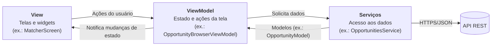

Como as regras de negócio (match, filtragem e interpretação dos editais) estão no backend, o aplicativo dispensa a camada de casos de uso da Clean Architecture prevista no RFC (ver [13](#13-decisões-técnicas-e-mudanças-em-relação-ao-rfc)). Assim, os ViewModels recebem os serviços por injeção, o que permite testá-los sem a interface e com serviços simulados.

### 9.3 Modelagem de dados

O banco de dados PostgreSQL, com a extensão PostGIS, armazena 8 tabelas. O diagrama a seguir apresenta as entidades, seus principais atributos e os relacionamentos.

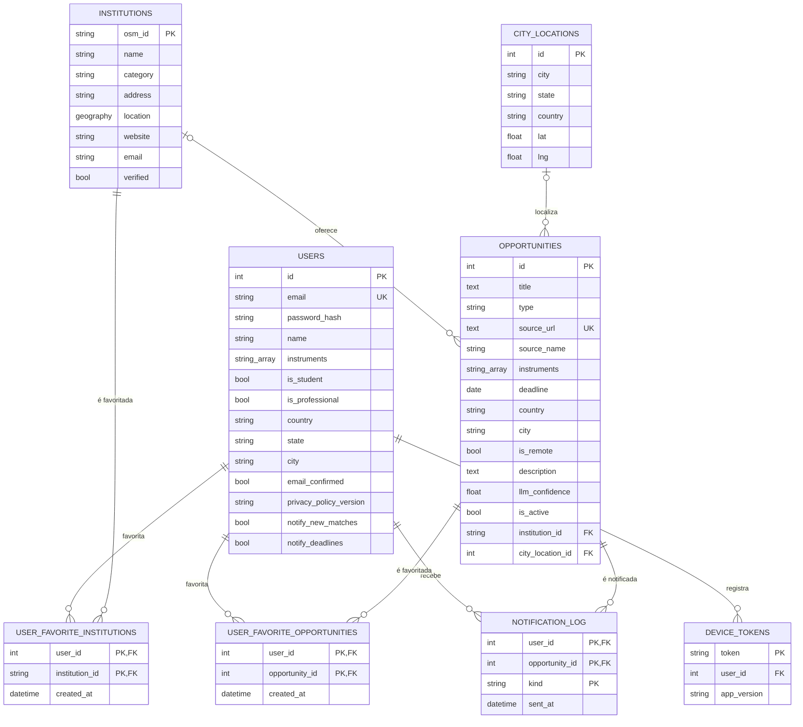

Destacam-se as seguintes decisões de modelagem:

- **Localização geográfica:** a coluna `location` das instituições utiliza o tipo `geography` do PostGIS, com índice espacial (GiST), o que permite buscar as instituições visíveis no mapa por raio e área de forma eficiente.
- **Instituições identificadas pelo OpenStreetMap:** a chave primária é o identificador do próprio OSM (`osm_id`), o que torna a atualização diária idempotente — uma instituição já existente é atualizada, e não duplicada.
- **Vínculo opcional entre oportunidade e instituição:** o sistema procura a instituição de cada oportunidade entre as já cadastradas (mesmo nome, até 50 km da cidade); se não a encontrar, localiza-a no OpenStreetMap pelo Nominatim e cria o marcador no mapa. Quando a instituição não existe como lugar no OpenStreetMap — caso comum de orquestras e concursos —, a oportunidade é associada ao centro da sua cidade (`city_locations`).
- **Exclusão em cascata:** ao excluir uma conta, os favoritos, os dispositivos registrados e o histórico de notificações do usuário são removidos automaticamente, atendendo à exclusão integral exigida pela LGPD.
- **Notificação única:** a tabela `notification_log` registra cada aviso enviado, garantindo que o mesmo usuário não seja notificado duas vezes sobre a mesma oportunidade.

### 9.4 Pipeline de dados e fontes

O pipeline de dados é executado pelo agendador da API em três rotinas diárias, que mantêm o mapa, as oportunidades e as notificações atualizados sem intervenção manual.

| Horário | Rotina | Etapas |
|---|---|---|
| 00h | Atualização do mapa | Consulta as instituições musicais do OpenStreetMap (QLever), insere ou atualiza cada uma pelo identificador do OSM e valida os dados com o MusicBrainz e o Wikidata. |
| 06h | Coleta de oportunidades | Coleta os editais das cinco fontes, desativa os retirados, interpreta os novos ou alterados com o Gemini, vincula cada oportunidade à instituição (ou ao centro da cidade) e limpa os favoritos que deixaram de estar disponíveis. |
| 09h | Notificações | Seleciona, para cada usuário, as novas oportunidades com match a partir de 85%, as favoritas com prazo próximo e a disponibilidade de nova versão, e envia os avisos pelo Firebase Cloud Messaging. |

>O **diagrama completo do pipeline** está em [docs/diagramas/pipeline-de-dados.md](docs/diagramas/pipeline-de-dados.md).

Algumas características do pipeline asseguram a sua robustez:

- **Reprocessamento mínimo:** apenas os editais novos ou cujo texto foi alterado são enviados ao Gemini, o que mantém o consumo dentro da cota gratuita; quando a cota do modelo principal se esgota, o sistema passa automaticamente para um modelo alternativo.
- **Tolerância a falhas das fontes:** se uma página estiver fora do ar ou vier vazia, nenhuma oportunidade daquela fonte é removida.
- **Filtragem na exibição:** a API exibe apenas oportunidades abertas, com prazo vigente e confiança de extração de pelo menos 80%, de modo que interpretações incertas não chegam ao usuário.

---

## 10. Diagrama de classes

Enquanto a modelagem de dados (seção [9.3](#93-modelagem-de-dados)) descreve como as informações são armazenadas no banco, o diagrama de classes descreve como o código do aplicativo está organizado. As classes seguem as camadas do padrão MVVM: os **ViewModels** herdam de uma classe base comum e utilizam os **serviços**, que acessam a API e criam os **modelos** de dados exibidos nas telas.

O diagrama de classes, com as relações entre as classes e os atributos e métodos de cada uma, está em [docs/diagramas/diagrama-de-classes.md](docs/diagramas/diagrama-de-classes.md).

No backend, a organização segue módulos: os *routers* expõem os endpoints da API, os *services* implementam as regras de negócio e o pipeline de dados, e as classes do ORM (SQLAlchemy) correspondem diretamente às tabelas apresentadas na modelagem de dados, razão pela qual não são repetidas neste diagrama.

---

## 11. Stack tecnológica

### 11.1 Aplicativo (frontend)

| Tecnologia | Versão | Uso |
|---|---|---|
| Dart / Flutter | Flutter 3.24.4 (Dart ^3.5.3) | Linguagem e framework do aplicativo Android |
| `google_maps_flutter` | ^2.5.0 | Mapa interativo de instituições |
| `http` | ^1.1.0 | Requisições à API REST e ao GeoNames |
| `flutter_secure_storage` | 9.2.4 | Armazenamento seguro do token de sessão |
| `shared_preferences` | ^2.5.3 | Preferências locais (tutorial, aceite da política no modo visitante, coleta de dados) |
| `firebase_messaging` | 16.2.0 | Recebimento de notificações |
| `firebase_analytics` | 12.3.0 | Métricas de uso |
| `firebase_crashlytics` | 5.2.0 | Registro de crashes/falhas no app |
| `app_links` | 6.3.2 | Abertura do aplicativo pelos links dos e-mails |
| `url_launcher` | ^6.3.1 | Abertura de editais, sites, e-mail e aplicativo de mapas |
| `package_info_plus` | 8.1.0 | Versão instalada, exibida no perfil e usada no aviso de atualização |
| `flutter_spinkit` | 5.2.1 | Indicadores de carregamento |
| `flutter_test` / `flutter_lints` | SDK / ^4.0.0 | Testes automatizados e análise estática |
| `flutter_launcher_icons` | ^0.14.4 | Geração do ícone do aplicativo |

### 11.2 Backend

| Tecnologia | Versão | Uso |
|---|---|---|
| Python | 3.12 | Linguagem do backend |
| FastAPI | ≥ 0.115 | Framework da API REST |
| Uvicorn | ≥ 0.30 | Servidor ASGI |
| SQLAlchemy | ≥ 2.0.36 | Mapeamento objeto-relacional (ORM) |
| GeoAlchemy2 | ≥ 0.15.2 | Tipos e funções geoespaciais do PostGIS |
| Psycopg | ≥ 3.2 | Driver do PostgreSQL |
| Pydantic Settings | ≥ 2.3 | Validação de dados e configuração por variáveis de ambiente |
| APScheduler | ≥ 3.10 | Agendamento das rotinas diárias |
| HTTPX | ≥ 0.27 | Requisições HTTP assíncronas às fontes e aos serviços externos |
| Beautiful Soup | ≥ 4.12 | Extração de conteúdo das páginas coletadas |
| Google GenAI SDK | ≥ 2.0 | Integração com o Gemini |
| Firebase Admin SDK | ≥ 6.5 | Envio das notificações |
| bcrypt | ≥ 4.2 | Hash das senhas |
| pycountry / Babel | ≥ 24.6 / ≥ 2.16 | Nomes de países e estados em português |
| pytest / pytest-cov | ≥ 8.0 / ≥ 5.0 | Testes automatizados e cobertura |

### 11.3 Dados, inteligência artificial e serviços externos

| Tecnologia | Uso |
|---|---|
| PostgreSQL 16 + PostGIS 3.4 | Banco de dados relacional com suporte geoespacial |
| Google Gemini (`gemini-3.5-flash`, com `gemini-3.5-flash-lite` como alternativa) | Interpretação dos editais |
| OpenStreetMap — QLever (SPARQL) e Nominatim | Instituições musicais e localização de cidades e instituições |
| MusicBrainz e Wikidata | Validação e complemento dos dados das instituições |
| GeoNames | Listas de países, estados e cidades no cadastro e no perfil |
| Google Maps Platform (Maps SDK for Android) | Exibição do mapa |
| Firebase Cloud Messaging, Analytics e Crashlytics | Notificações, métricas e falhas |
| Resend | Envio de e-mails transacionais |

### 11.4 Infraestrutura, DevOps e qualidade

| Tecnologia | Uso |
|---|---|
| Hostinger VPS (Ubuntu 24.04) | Servidor de produção, no Brasil |
| Docker e Docker Compose | Execução do banco, da API e do servidor web em contêineres |
| Caddy 2 | Servidor web, proxy reverso e certificados HTTPS automáticos (Let's Encrypt) |
| UFW e fail2ban | Firewall e bloqueio de tentativas de acesso indevido |
| GitHub e GitHub Actions | Versionamento, integração contínua e implantação da API (CI/CD), e publicação do APK (release) |
| SonarCloud | Análise estática e Quality Gate (projetos separados para a API e o aplicativo) |
| UptimeRobot | Monitoramento da disponibilidade da API e do site |
| Registro.br | Registro do domínio `musiconnect.app.br` e configuração do DNS (registros A de `musiconnect.app.br` e `api.musiconnect.app.br` apontando para o servidor) |

>**UptimeRobot:** indisponibilidades temporárias são previstas nas rotinas de atualização diárias (00h e 6h), no backup diário do banco e no deploy automático executado a cada push na branch *main*, visto que o CI reconstrói e reinicia o contêinerda API.

### 11.5 Ferramentas de desenvolvimento

| Ferramenta | Uso |
|---|---|
| Visual Studio Code | Editor de código |
| Android Studio | Instalação do Android SDK (assistente de configuração inicial), das *Command-line Tools* (SDK Manager) e aceite das licenças do SDK, necessários à compilação pelo Flutter |
| Android SDK e JDK 17 | Compilação do aplicativo Android |
| Mermaid e PlantUML | Diagramas desta documentação |
| Claude Code | Assistente de programação com IA, utilizadas na elaboração dos tópicas da documentação e de sua revisão, bem como no apoio a estruturação de texto, revisão de clareza e sugestões de melhoria no projeto. |

>**Claude Code:** Todos os programas, a arquitetura de software e de dados, a estrura e os demais tópicos do projeto foram <u>revisados e validados pela autora</u>, que assume integral responsabilidade pelo trabalho.

---

## 12. Documentação da API

A API do MusiConnect segue o estilo REST: as requisições e respostas utilizam JSON e trafegam exclusivamente por HTTPS. A documentação completa é gerada automaticamente pelo FastAPI a partir do próprio código, no padrão **OpenAPI**, o que a mantém sempre sincronizada com a implementação.

| Recurso | Endereço |
|---|---|
| URL base | `https://api.musiconnect.app.br` |
| Documentação interativa (Swagger UI) | [api.musiconnect.app.br/docs](https://api.musiconnect.app.br/docs) |
| Documentação para leitura (ReDoc) | [api.musiconnect.app.br/redoc](https://api.musiconnect.app.br/redoc) |
| Especificação OpenAPI (JSON) | [api.musiconnect.app.br/openapi.json](https://api.musiconnect.app.br/openapi.json) |

<p align="center">
  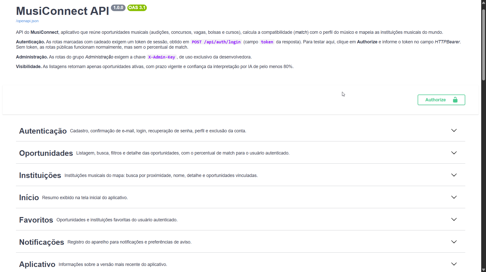<br>
  <sub>Página inicial da documentação interativa da API. Fonte: Swagger UI do MusiConnect, captura em 07/11/2026. Disponível em: <a href="https://api.musiconnect.app.br/docs">api.musiconnect.app.br/docs</a>.</sub>
</p>

No Swagger UI, cada rota apresenta a sua descrição, os parâmetros, o formato da requisição e das respostas, os erros possíveis e a descrição de cada campo; o botão **Try it out** permite executar a rota diretamente pelo navegador.

>Um **exemplo de requisição e resposta** está em [docs/exemplo-de-uso-da-api.md](docs/exemplo-de-uso-da-api.md).

### 12.1 Autenticação

- **Usuário:** o login (`POST /api/auth/login`) retorna um token de sessão, que deve ser enviado nas demais requisições no cabeçalho `Authorization: Bearer <token>`. O token é aleatório, armazenado de forma segura no aparelho e invalidado ao sair da conta ou trocar a senha. No Swagger UI, o token é informado pelo botão **Authorize**.
- **Autenticação opcional:** as rotas de consulta (oportunidades, instituições e tela inicial) funcionam sem token, o que viabiliza o modo visitante; com token, passam a retornar o percentual de match.
- **Administração:** as rotas do grupo Administração exigem a chave `X-Admin-Key`, de uso exclusivo da desenvolvedora.

### 12.2 Grupos de rotas

| Grupo | Prefixo | Rotas | Principais operações | Autenticação |
|---|---|:---:|---|---|
| Autenticação | `/api/auth` | 13 | Cadastro, confirmação de e-mail, login, recuperação e troca de senha, perfil, aceite da política, saída e exclusão da conta | Obrigatória nas rotas do perfil |
| Oportunidades | `/api/opportunities` | 5 | Listagem com busca e filtros, opções dos filtros, detalhe, contagem de matches e marcadores de cidade | Opcional (obrigatória na contagem de matches) |
| Instituições | `/api/institutions` | 6 | Busca por proximidade e por nome, detalhe, estatísticas e oportunidades de cada instituição | Opcional |
| Início | `/api/dashboard` | 1 | Resumo da tela inicial | Opcional |
| Favoritos | `/api/favorites` | 7 | Listar, adicionar e remover oportunidades e instituições favoritas | Obrigatória |
| Notificações | `/api/notifications` | 2 | Registro do aparelho e preferências de aviso | Obrigatória |
| Aplicativo | `/api/app` | 1 | Versão mais recente do aplicativo | Não |
| Administração | `/scheduler` e `/api/opportunities` | 5 | Disparo manual das rotinas do pipeline e status do agendador | Chave `X-Admin-Key` |
| Sistema | `/` | 1 | Verificação de disponibilidade | Não |

### 12.3 Códigos de resposta

| Código | Significado |
|---|---|
| 200 / 201 / 204 | Sucesso (consulta, criação ou operação sem conteúdo de retorno) |
| 400 | Link de confirmação ou de redefinição inválido ou expirado |
| 401 | Sessão ausente ou inválida, ou credenciais incorretas |
| 403 | E-mail ainda não confirmado, ou chave de administração ausente ou incorreta |
| 404 | Recurso não encontrado |
| 409 | Conflito, como e-mail já cadastrado |
| 422 | Dados inválidos, como senha fraca ou campo obrigatório ausente |

Os erros seguem o formato padrão do FastAPI, com a mensagem em português: `{"detail": "E-mail já cadastrado."}`.

---

## 13. Decisões técnicas e mudanças em relação ao RFC

Ao longo do desenvolvimento, parte do que foi previsto na proposta original (RFC — Relatório Final do PAC Extensionista VII) foi ajustada. As mudanças partiram, principalmente, do retorno recebido na avaliação da proposta, que apontou como risco a **"amplitude excessiva do escopo"** de Inteligência Artificial (*clustering* e RAG), a instabilidade dos robôs de coleta e o custo de uso de modelos de linguagem em larga escala. Esta seção registra cada decisão, a alternativa considerada e o seu *trade-off* — isto é, o que se ganha e do que se abre mão com a escolha.

### 13.1 Mudanças em relação ao RFC

| Previsto no RFC | Decisão | Motivo | Trade-off |
|---|---|---|---|
| Arquitetura RAG com banco vetorial (pgvector) | Interpretação dos editais por **extração direta com o Gemini** | Os editais são textos curtos, que cabem inteiros na requisição ao modelo; não há base documental extensa a ser recuperada por similaridade, que é o problema que o RAG resolve | **Ganho:** simplicidade, menor custo e menos componentes a manter; **Perda:** busca semântica por *embeddings*, que não era necessária para o problema |
| Recomendação por *Machine Learning* (*clustering* e *matching*) | **Match por regras ponderadas** (instrumento 45, afinidade 20, localização 20, confiança 15) | Um modelo de agrupamento exigiria uma base grande de usuários e de interações, inexistente no lançamento; as regras são explicáveis ao usuário, que vê a pontuação de cada fator | **Ganho:** transparência, previsibilidade e funcionamento desde o primeiro usuário; **Perda:** ajuste automático dos pesos com o uso |
| Perfil com instrumento, nível técnico, repertório e objetivos (RF.2 e RF.3) | **Nível técnico, repertório e objetivos de carreira fora do perfil** | A maioria dos editais não informa o nível nem o repertório exigido; os critérios resultariam majoritariamente em "Não informado" e não diferenciariam as oportunidades | **Ganho:** cadastro mais curto e match baseado em dados que existem; **Perda:** possibilidade de diferenciar oportunidades por nível |
| Clean Architecture | **Arquitetura MVVM** no aplicativo | É o padrão recomendado pela documentação oficial do Flutter e separa interface, estado e dados; a camada de casos de uso seria redundante, pois as regras de negócio estão no backend | **Ganho:** menos camadas e código mais direto; **Perda:** a independência total das regras em relação ao framework, que no projeto residem no servidor |
| Overpass API | **QLever** (SPARQL) para obter as instituições do OpenStreetMap | O serviço público do Overpass excedia o tempo limite em regiões extensas, limitava os resultados por consulta e retornava listas vazias sem indicar erro; a base ficava restrita a cerca de 16 mil instituições | **Ganho:** cobertura (mais de 82 mil instituições) com consultas paginadas; **Perda:** dependência de um serviço acadêmico, sem garantia formal de disponibilidade |
| Sugestão da avaliação: aprovação manual de cada edital pela coordenação da SCAR antes da publicação | **Controle de qualidade automático** dos editais | O volume diário de editais tornaria inviável a revisão individual; a qualidade é assegurada pela nota de confiança da IA (mínimo de 80%), pelo descarte do que não é chamada aberta ou participação ativa e pelo aviso "O Matcher é uma IA e pode cometer erros", com link para a fonte oficial | **Ganho:** atualização contínua e independência de revisão humana; **Perda:** possibilidade de que um erro pontual de interpretação chegue ao usuário |

### 13.2 Demais decisões técnicas

Outras decisões que orientaram a construção do sistema — hospedagem, uso da cota gratuita do Gemini, tratamento de oportunidades sem instrumento, repetição entre fontes, seleção das fontes, horário das notificações, modo visitante, distribuição por APK e política de backup — estão registradas, no mesmo formato, em [docs/decisoes-tecnicas.md](docs/decisoes-tecnicas.md).

---

## 14. Metodologia de desenvolvimento

O MusiConnect foi desenvolvido de forma **iterativa e incremental**, organizada em **fluxo Kanban** e apoiada por **integração e entrega contínuas**. O produto cresceu em pequenas entregas funcionais — mapa, oportunidades, match, favoritos, notificações, modo visitante, entre outras —, cada uma publicada assim que concluída, em vez de ser construído por inteiro e entregue apenas ao final.

As tarefas foram mantidas em uma lista priorizada, registrada em um arquivo de planejamento local, com seções de itens a fazer e concluídos. Seguindo o princípio do Kanban, apenas **uma tarefa permanecia em andamento por vez**, sem ciclos de duração fixa. O cronograma mensal definido no RFC serviu de referência inicial, mas a execução foi conduzida pela prioridade de cada tarefa, e não por datas. O Scrum não foi adotado, por pressupor papéis, *sprints* e cerimônias pensados para equipes, e não para um projeto individual.

Uma tarefa era considerada concluída quando estava implementada, coberta por testes automatizados, conferida em um dispositivo real e aprovada pela desenvolvedora antes do *commit*.
>O desenvolvimento contou com o apoio do assistente de programação Claude Code, **sempre sob revisão e aprovação da desenvolvedora**.

### 14.1 Ciclo de cada tarefa

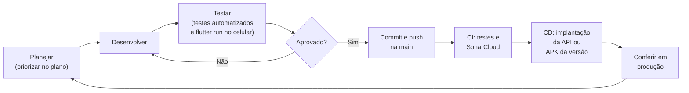

Cada mudança passa pelos testes automatizados do backend (372) e do aplicativo (266), executados localmente e, de novo, pelo pipeline de integração contínua a cada envio ao repositório. Na maior parte das funcionalidades, os testes foram escritos junto com o código ou logo após a implementação; nas correções de defeitos, adotou-se a prática do TDD: primeiro, um teste que reproduz o erro e falha; em seguida, a correção que o faz passar. Os detalhes do pipeline e dos testes estão na seção [15](#15-cicd-testes-qualidade-privacidade-e-monitoramento).

### 14.2 Controle de versão

- **Ramo único (*trunk-based development*):** todo o desenvolvimento ocorre diretamente na `main`, protegida pela integração contínua; cada *push* aprovado pelo pipeline é implantado automaticamente.
- **Conventional Commits:** as mensagens seguem um padrão que identifica o tipo de cada alteração. Até 07/11/2026, o histórico soma 117 *commits*, dos quais 56 de novas funcionalidades (`feat`), 24 de correções (`fix`), 11 de testes (`test`), 8 de refatorações (`refactor`) e os demais de documentação, configuração e pipeline (`docs`, `chore`, `ci`, `build`).
- **Versionamento semântico do aplicativo:** cada versão publicada recebe uma *tag* (`v1.0.0` a `v1.2.6`), que gera automaticamente o APK assinado disponível para download.

<p align="center">
  <a href="https://github.com/DevLuchez/prototipo-musiconnect">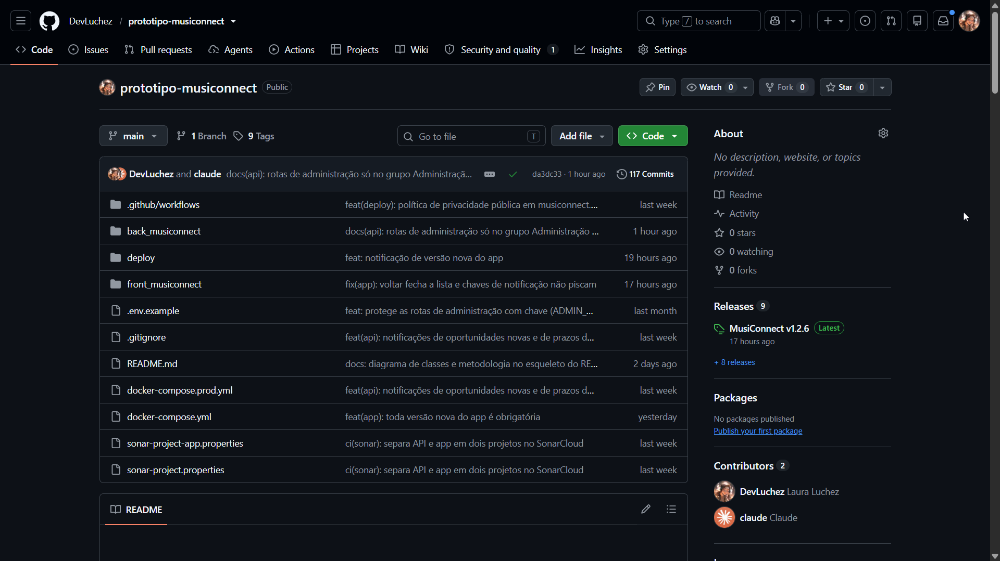</a><br>
  <sub>Repositório do projeto, com ramo único, 117 commits, 9 tags e 9 releases. Fonte: GitHub, captura em 07/11/2026. Disponível em: <a href="https://github.com/DevLuchez/prototipo-musiconnect">github.com/DevLuchez/prototipo-musiconnect</a>.</sub>
</p>

### 14.3 Participação do cliente

A SCAR participou em dois momentos principais:
- O primeiro encontro com o coordenador de música, em **13 de março de 2026**, definiu o problema e o escopo do projeto.
- O segundo, em **10 de outubro de 2026**, ocorreu com o aplicativo já construído, antes da sua publicação no servidor, e validou as funcionalidades implementadas; dele surgiram as sugestões do tutorial no primeiro acesso e do modo visitante, incorporadas em seguida.

A partir de então, o coordenador passou a ser informado à medida que novas mudanças e funcionalidades eram aplicadas. Os resultados da validação são apresentados na seção [16](#16-resultados-e-validação-com-o-cliente).

---

## 15. CI/CD, testes, qualidade, privacidade e monitoramento

### 15.1 CI/CD

O projeto utiliza dois *workflows* do **GitHub Actions**:

- **Integração contínua (`ci.yml`)**, executada a cada envio à `main`:
  1. **Backend:** sobe um banco PostgreSQL/PostGIS de teste e executa os testes da API com medição de cobertura.
  2. **Aplicativo:** executa a análise estática do Flutter (`flutter analyze`) e os testes com cobertura; verifica também se a página pública da política de privacidade está idêntica ao texto exibido no aplicativo.
  3. **SonarCloud:** envia o código e a cobertura para análise de qualidade e segurança, em dois projetos separados (API e aplicativo).
  4. **Implantação (CD):** se o backend e o aplicativo forem aprovados, o servidor é atualizado automaticamente por SSH, com uma chave restrita a executar apenas o script de atualização (`deploy/update.sh`), que reconstrói e reinicia os contêineres.
- **Publicação do aplicativo (`release.yml`)**, executada a cada *tag* de versão (`v*`): gera o APK assinado com a chave de *release* e o publica no GitHub Releases. A página de download aponta sempre para a versão mais recente.

<p align="center">
  <a href="https://github.com/DevLuchez/prototipo-musiconnect/actions">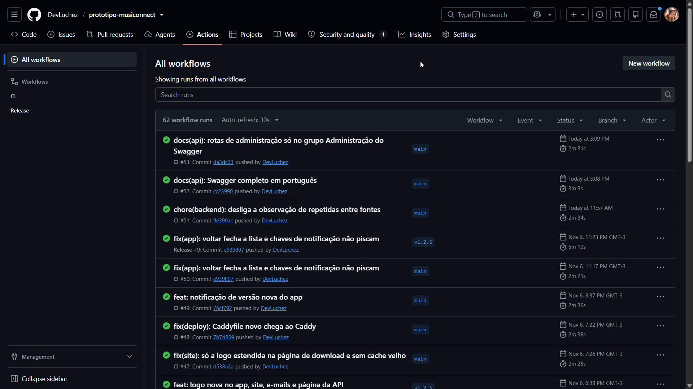</a><br>
  <sub>Execuções dos workflows de integração e entrega contínuas. Fonte: GitHub Actions, captura em 07/11/2026. Disponível em: <a href="https://github.com/DevLuchez/prototipo-musiconnect/actions">github.com/DevLuchez/prototipo-musiconnect/actions</a>.</sub>
</p>

As credenciais utilizadas pelos *workflows* (chave de assinatura, configuração do Firebase, token do SonarCloud e chave de implantação) ficam armazenadas como *secrets* do repositório, fora do código.

### 15.2 Testes

| Camada | Quantidade | Tipos de teste | Cobertura (SonarCloud) |
|---|:---:|---|:---:|
| Backend (pytest) | 372 | Testes de unidade das regras de negócio (match, senhas, interpretação de textos e coletores, com as fontes simuladas) e testes de integração das rotas da API sobre um banco PostgreSQL/PostGIS real, separado do banco de desenvolvimento | 99,8% |
| Aplicativo (flutter_test) | 266 | Testes de unidade dos modelos, serviços e ViewModels (com serviços simulados) e testes de *widget* das telas e componentes | 89,3% |
| Aplicativo, instrumentados (integration_test) | 3 | Executados no aplicativo real, em um dispositivo Android, contra a API pública: o visitante entra e navega pelas quatro abas; abre uma oportunidade e recebe o convite ao favoritar; e o login com credenciais inválidas exibe o erro | — |

Os testes priorizam as regras de negócio: o cálculo do match, a filtragem das oportunidades visíveis, a interpretação e o descarte de editais, o aceite da política de privacidade, a autenticação e as notificações. Nas correções de defeitos, um teste que reproduz o erro é escrito antes da correção, de modo que o defeito não volte a ocorrer. Os testes instrumentados, por dependerem de um aparelho, são executados manualmente antes de cada versão; na primeira execução, revelaram um texto de botão cortado em janelas estreitas, corrigido em seguida. Além dos testes automatizados, cada funcionalidade é conferida em um dispositivo Android real antes da publicação.

### 15.3 Qualidade e segurança do código

A análise estática é feita pelo **SonarCloud**, com o Quality Gate aplicado separadamente à API e ao aplicativo. Situação em 07/11/2026:

| Indicador | API | Aplicativo |
|---|:---:|:---:|
| Quality Gate | ✅ Aprovado | ✅ Aprovado |
| Bugs | 0 | 0 |
| Vulnerabilidades | 0 | 0 |
| *Security hotspots* | 0 | 0 |
| *Code smells* | 0 | 0 |
| Cobertura de testes | 99,8% | 89,3% |
| Linhas duplicadas | 0,0% | 4,9% |
| Notas de confiabilidade, segurança e manutenibilidade | A | A |

<table>
  <tr>
    <td align="center"><a href="https://sonarcloud.io/summary/overall?id=DevLuchez_prototipo-musiconnect"></a><br><sub>Análise de qualidade da API. Fonte: SonarCloud, captura em 07/11/2026. Disponível em: <a href="https://sonarcloud.io/summary/overall?id=DevLuchez_prototipo-musiconnect">sonarcloud.io (API)</a>.</sub></td>
    <td align="center"><a href="https://sonarcloud.io/summary/overall?id=DevLuchez_prototipo-musiconnect-app"></a><br><sub>Análise de qualidade do aplicativo. Fonte: SonarCloud, captura em 07/11/2026. Disponível em: <a href="https://sonarcloud.io/summary/overall?id=DevLuchez_prototipo-musiconnect-app">sonarcloud.io (aplicativo)</a>.</sub></td>
  </tr>
</table>

Em segurança, destacam-se:

- **Comunicação:** HTTPS em todos os endereços, com certificados emitidos e renovados automaticamente pelo Caddy (Let's Encrypt).
- **Autenticação:** senhas armazenadas com *hash* bcrypt e sujeitas a uma política mínima; tokens de sessão aleatórios, guardados no armazenamento seguro do aparelho e invalidados ao sair da conta ou trocar a senha; links de confirmação e de redefinição de senha com validade limitada (24 horas e 15 minutos).
- **Administração:** rotas administrativas protegidas por chave, comparada em tempo constante.
- **Servidor:** acesso SSH somente por chave, firewall (UFW) com apenas as portas 22, 80 e 443 abertas, bloqueio de tentativas de acesso indevido (fail2ban) e banco de dados sem porta exposta à internet.
- **Credenciais:** chaves e senhas fora do repositório (arquivo `.env` no servidor e *secrets* do GitHub); a chave do Google Maps, embutida no aplicativo, é restrita ao pacote do MusiConnect e às impressões digitais das suas chaves de assinatura.

### 15.4 Privacidade e LGPD

- **Política de privacidade** acessível no aplicativo e publicada em [musiconnect.app.br/privacidade](https://musiconnect.app.br/privacidade), gerada a partir do mesmo texto exibido no app (o pipeline de CI falha se as duas versões divergirem).
- **Consentimento explícito e versionado:** o cadastro e o modo visitante exigem o aceite da política; a versão aceita é registrada e, quando a política muda, o aplicativo solicita um novo aceite, destacando os trechos alterados.
- **Coleta mínima:** apenas nome, e-mail, senha (em *hash*), instrumentos, ramo de atuação, localização, favoritos e, se autorizado, o identificador do aparelho para notificações.
- **Dados de uso opcionais:** as métricas de uso e o registro de falhas (Firebase) podem ser desligados no perfil, não incluem nome nem e-mail e não utilizam identificador de publicidade.
- **Direito à exclusão:** a exclusão da conta remove todos os dados do usuário (favoritos, aparelhos e histórico de notificações); cópias em backup são descartadas em até 14 dias.
- **Notificações** somente mediante autorização, com controle individual de cada tipo de aviso no perfil.

### 15.5 Monitoramento

| Ferramenta | O que monitora |
|---|---|
| Firebase Analytics | Uso do aplicativo, se autorizado: telas acessadas e eventos como cadastro, login, início do modo visitante, início do tutorial, aplicação de filtros, visualização de oportunidades e favoritos |
| Firebase Crashlytics | Falhas e erros do aplicativo nos aparelhos dos usuários |
| UptimeRobot | Disponibilidade da API e do site, verificada a cada 5 minutos, com alerta por e-mail em caso de queda |
| Painel da Hostinger | Uso de CPU, memória, disco e tráfego do servidor |
| Resend | Entrega dos e-mails de confirmação de cadastro e de redefinição de senha |
| Logs dos contêineres | Execução das rotinas diárias (coleta, interpretação pela IA, atualização do mapa e notificações), com registro de erros e de editais descartados |

<table>
  <tr>
    <td align="center"><br><sub>Métricas de uso do aplicativo. Fonte: Firebase Analytics (painel privado), captura em 07/11/2026.</sub></td>
    <td align="center"><br><sub>Registro de falhas do aplicativo. Fonte: Firebase Crashlytics (painel privado), captura em 07/11/2026.</sub></td>
  </tr>
</table>

<table>
  <tr>
    <td align="center"><br><sub>Disponibilidade da API e do site. Fonte: UptimeRobot (painel privado), captura em 07/11/2026.</sub></td>
    <td align="center"><br><sub>Uso de recursos do servidor (dados de acesso ocultados). Fonte: Hostinger (painel privado), captura em 07/11/2026.</sub></td>
    <td align="center"><br><sub>E-mails enviados pelo sistema (destinatários ocultados). Fonte: Resend (painel privado), captura em 07/11/2026.</sub></td>
  </tr>
</table>

>*O GitHub, o GitHub Actions e o SonarCloud são públicos; o Firebase, o UptimeRobot, a Hostinger e o Resend são painéis privados, com acesso restrito à conta da desenvolvedora.*

---

## 16. Resultados e validação com o cliente

### 16.1 Resultados

O MusiConnect está em produção, com o aplicativo Android disponível para download em [musiconnect.app.br](https://musiconnect.app.br) (em breve, disponível na Play Store) e a API pública em funcionamento contínuo. Em 07/11/2026, o sistema apresentava os seguintes resultados:

| Indicador | Resultado |
|---|---|
| Oportunidades abertas | 434, sendo 214 audições, 119 competições, 79 cursos e 22 vagas de emprego |
| Abrangência das oportunidades | 40 países e 202 cidades, com 38 instrumentos distintos; 23 oportunidades no Brasil |
| Fontes de oportunidades | 5, coletadas diariamente: Musical Chairs (347), WFIMC (62), Revista CONCERTO (17), SCAR (7) e FEMUSC (1) |
| Instituições no mapa | 82.641 instituições musicais, das quais 30 com oportunidades abertas |
| Atualização dos dados | Automática e diária: mapa às 00h, oportunidades às 06h e notificações às 09h, sem intervenção manual |
| Versões publicadas | 9 versões do aplicativo (v1.0.0 a v1.2.6) |
| Uso do aplicativo | 13 instalações ativas nos últimos 30 dias, incluindo as de teste da desenvolvedora e o modo visitante (Firebase Analytics, que contabiliza aparelhos, e não contas) |
| Estabilidade | 92,31% dos usuários e 98,59% das sessões sem falhas nos últimos 7 dias (Firebase Crashlytics) |
| Disponibilidade | 99,648% da API e 100% do site nas últimas 24 horas (UptimeRobot) |
| Qualidade do código | Quality Gate aprovado na API e no aplicativo, sem bugs, vulnerabilidades ou *code smells* (SonarCloud) |
| Testes automatizados | 372 no backend (99,8% de cobertura) e 266 no aplicativo (89,3% de cobertura) |

Em termos de entrega ao público beneficiado, o aplicativo reúne em um único lugar, em português e ordenadas pela compatibilidade com o perfil de cada músico, oportunidades que antes precisavam ser procuradas manualmente em portais dispersos e, na maioria, em outros idiomas. Cada edital é apresentado com um resumo objetivo e os dados essenciais (tipo, instrumentos, local e prazo), e o usuário é avisado das oportunidades mais compatíveis e dos prazos dos seus favoritos.

### 16.2 Validação com o cliente

> 🚧 Em construção: relato da validação com o coordenador de música da SCAR.

---

## 17. Aderência à linha de Aplicações Mobile

As tabelas a seguir relacionam os critérios da [linha de projeto de Aplicações Mobile](https://github.com/CatolicaSC-Portfolio/The-Portfolio-Playbook/blob/main/directions/portfolio-directions-mobile.md) do Portfólio de Engenharia de Software da Católica SC à forma como o MusiConnect os atende, com a seção desta documentação que apresenta a evidência.

**Legenda:** ✅ atendido · ⏳ em andamento · ⚠️ atendido parcialmente · ❌ não atendido

### 17.1 Requisitos obrigatórios

| Critério | Como o MusiConnect atende | Evidência | Situação |
|---|---|---|:---:|
| Aplicativo em ambiente produtivo, acessível para instalação e testes | APK assinado disponível em [musiconnect.app.br](https://musiconnect.app.br), com API pública em servidor próprio | [19](#19-instalação-e-deploy) | ✅ |
| Funcionalidades reais e completas, alinhadas ao escopo do RFC | Oportunidades coletadas diariamente, match, mapa, favoritos e notificações em funcionamento; alterações em relação ao RFC justificadas | [3](#3-funcionalidades-e-diferencial), [5.3](#53-rastreabilidade-com-o-rfc), [13](#13-decisões-técnicas-e-mudanças-em-relação-ao-rfc) | ✅ |
| Arquitetura mobile compatível (ex.: MVC, MVVM, Clean Architecture) | MVVM, padrão recomendado pela documentação oficial do Flutter | [9.2](#92-arquitetura-do-aplicativo-mvvm) | ✅ |
| Código-fonte em repositório versionado, com histórico de commits e organização de branches | Repositório público no GitHub, com *trunk-based development* na `main`, Conventional Commits e versões marcadas por *tags* | [14.2](#142-controle-de-versão) | ✅ |
| Interface funcional e navegável, testável em dispositivo real, com QR Code no pôster | Aplicativo conferido em dispositivo Android real a cada entrega; QR Code apontando para a página de download | [3.1](#31-funcionalidades), [8](#8-estrutura-de-navegação) | ✅ |
| Documentação: requisitos funcionais | Requisitos funcionais RF01 a RF26 | [5.1](#51-requisitos-funcionais) | ✅ |
| Documentação: casos de uso ou *user stories* | Atores, diagramas e descrição dos casos de uso UC01 a UC19 | [6](#6-casos-de-uso) | ✅ |
| Documentação: estrutura de navegação | Padrões de navegação, mapa de navegação e elementos de navegação | [8](#8-estrutura-de-navegação) | ✅ |
| Documentação: diagrama de arquitetura | Modelo C4 (contexto e contêineres), arquitetura do aplicativo e modelagem de dados | [9](#9-arquitetura) | ✅ |
| Documentação: instruções de deploy ou instalação | Instalação do aplicativo, execução local e implantação | [19](#19-instalação-e-deploy), [20](#20-execução-local) | ✅ |
| Ao menos três fluxos de uso completos | Cadastro e primeiro acesso; encontrar e acompanhar uma oportunidade; explorar instituições no mapa | [7](#7-fluxos-de-uso) | ✅ |
| Documentação junto ao repositório | Documentação completa neste README, com materiais de apoio na pasta `docs/`, conforme orientação da professora | Este documento | ✅ |
| Pipeline de CI/CD | GitHub Actions com testes, análise estática, implantação da API e publicação do APK | [15.1](#151-cicd) | ✅ |
| Análise estática de código e segurança | SonarCloud com Quality Gate aprovado na API e no aplicativo | [15.3](#153-qualidade-e-segurança-do-código) | ✅ |
| Monitoramento ou observabilidade | Firebase Analytics, Firebase Crashlytics e UptimeRobot | [15.5](#155-monitoramento) | ✅ |
| Backend próprio: TDD e cobertura de testes (regras de Web Apps: 75% no backend e 25% no frontend) | 99,8% de cobertura no backend e 89,3% no aplicativo; testes escritos junto com o código e TDD nas correções de defeitos | [14.1](#141-ciclo-de-cada-tarefa), [15.2](#152-testes) | ✅ |

### 17.2 Requisitos desejáveis

| Critério | Como o MusiConnect atende | Evidência | Situação |
|---|---|---|:---:|
| Publicação em loja oficial | Publicação no Google Play em andamento, aguardando a verificação de identidade exigida pelo Google | [19](#19-instalação-e-deploy) | ⏳ |
| Integração com serviços externos (APIs REST, mapas, notificações *push*) | API REST própria, Google Maps, Firebase Cloud Messaging, Gemini, OpenStreetMap, GeoNames e Resend | [9.1](#91-visão-geral-modelo-c4), [11.3](#113-dados-inteligência-artificial-e-serviços-externos) | ✅ |
| Testes instrumentados (em dispositivo ou emulador) | Testes com o pacote `integration_test`, executados em dispositivo Android real: navegação do visitante, abertura de oportunidade e login inválido | [15.2](#152-testes) | ✅ |
| Responsividade e adaptação a diferentes telas | Layouts flexíveis do Flutter, conferidos em celular e em tablet Android | [3.1](#31-funcionalidades), [tela em tablet](docs/img/telas/cadastrado/tablet-matcher.jpg) | ✅ |
| Boas práticas de UX/UI | Material Design, identidade visual própria, tutorial guiado, retorno em ações importantes (carregamento, erros e confirmações) | [3.1](#31-funcionalidades), [8](#8-estrutura-de-navegação) | ✅ |
| Persistência de dados local no dispositivo | Armazenamento seguro do token de sessão e preferências locais (tutorial, aceite da política no modo visitante e coleta de dados) | [11.1](#111-aplicativo-frontend) | ✅ |
| Testes de integração | Testes das rotas da API sobre um banco PostgreSQL/PostGIS real | [15.2](#152-testes) | ✅ |

### 17.3 Diferenciais

| Critério | Como o MusiConnect atende | Evidência | Situação |
|---|---|---|:---:|
| Autenticação robusta (login social, OAuth2, biometria, MFA) | Autenticação por e-mail e senha, com confirmação de e-mail e política de senha; não há login social, biometria nem MFA | [15.3](#153-qualidade-e-segurança-do-código) | ❌ |
| Métricas de uso e comportamento integradas | Firebase Analytics com eventos de cadastro, login, modo visitante, tutorial, filtros, visualização e favoritos | [15.5](#155-monitoramento) | ✅ |
| Interface multilíngue | Interface somente em português; os editais em outros idiomas são traduzidos e resumidos pela IA | [2.3](#23-limitações) | ❌ |
| Arquitetura modular ou micro frontends | Organização em camadas (MVVM), sem módulos independentes | [9.2](#92-arquitetura-do-aplicativo-mvvm) | ❌ |
| Testes com usuários reais e feedback documentado | Validação com o coordenador de música da SCAR; teste com estudantes previsto no teste fechado do Google Play | [16.2](#162-validação-com-o-cliente) | ⏳ |
| Design System ou biblioteca de componentes reutilizáveis | Componentes reutilizados em várias telas (cartão de oportunidade, indicador de match, botão de favorito, filtros, convite ao visitante) e tema com cores e avisos padronizados | [10](#10-diagrama-de-classes) | ⚠️ |
| Infraestrutura como Código ou automação de deploy mobile | Infraestrutura descrita em arquivos Docker Compose e Caddyfile; APK assinado gerado e publicado automaticamente a cada versão | [15.1](#151-cicd) | ✅ |
| Mensageria e notificações assíncronas | Notificações *push* pelo Firebase Cloud Messaging, enviadas diariamente pelo agendador | [3.1](#31-funcionalidades), [9.4](#94-pipeline-de-dados-e-fontes) | ✅ |

---

## 18. Trabalhos futuros

A partir das limitações identificadas (seção [2.3](#23-limitações)), das decisões tomadas ao longo do desenvolvimento (seção [13](#13-decisões-técnicas-e-mudanças-em-relação-ao-rfc)) e do retorno do público beneficiado (seção [16.2](#162-validação-com-o-cliente)), destacam-se as seguintes possibilidades de evolução:

**Produto e alcance**

- **Expansão para outras instituições de ensino musical**, além da SCAR, com conservatórios e escolas de música de outras cidades.
- **Versão para iOS**, aproveitando o código multiplataforma do Flutter.
- **Interface em outros idiomas**, como inglês e espanhol, ampliando o público para além do Brasil.
- **Comunicação direta entre músicos e instituições** dentro do aplicativo, mantendo o foco na profissionalização.

**Dados e inteligência**

- **Match que aprende com o uso**, ajustando os pesos de cada fator a partir das oportunidades que o usuário abre, favorita ou descarta, quando houver uma base de usuários suficiente.
- **Nível técnico e repertório no perfil**, caso as fontes passem a informar esses requisitos de forma consistente.
- **Publicação de oportunidades pelas próprias instituições**, como a SCAR, com revisão opcional pela coordenação antes da exibição.

**Engenharia e infraestrutura**

- **Autenticação adicional**, como conta da Google ou da Microsoft.
- **Testes instrumentados no pipeline de CI**, executados em emulador a cada envio ao repositório.
- **Cópia do backup em outro provedor** e redundância do servidor, reduzindo o risco de um ponto único de falha.

---

## 19. Instalação e deploy

### 19.1 Instalação do aplicativo

O MusiConnect está disponível para Android 6.0 ou superior (o APK tem cerca de 56 MB).

<p align="center">
  <a href="https://musiconnect.app.br"></a><br>
  <sub>QR Code de acesso à página de download. Fonte: elaborado pela autora (2026). Disponível em: <a href="https://musiconnect.app.br">musiconnect.app.br</a>.</sub>
</p>

1. No celular, leia o QR Code acima ou acesse [musiconnect.app.br](https://musiconnect.app.br) e toque em **Baixar para Android**.
2. Quando o download terminar, toque em **Abrir** no aviso do navegador.
3. Se o Android perguntar com qual aplicativo abrir o arquivo, escolha o **Instalador do pacote**. Se solicitar, permita a instalação de aplicativos desta fonte — a permissão é exigida para aplicativos instalados fora da loja.
4. Toque em **Instalar** e, ao final, em **Abrir**.
5. Crie uma conta, entre com uma conta existente ou toque em **Entrar sem uma conta cadastrada** para conhecer o aplicativo como visitante.

<table>
  <tr>
    <td align="center"><br><sub>1. Página de download</sub></td>
    <td align="center"><br><sub>2. Download concluído</sub></td>
    <td align="center"><br><sub>3. Instalador do pacote</sub></td>
    <td align="center"><br><sub>4. Instalar</sub></td>
    <td align="center"><br><sub>5. Aplicativo instalado</sub></td>
  </tr>
</table>

Quando uma nova versão é publicada, o aplicativo exibe um aviso de atualização obrigatória e encaminha o usuário à página de download; basta instalar por cima da versão atual, sem perder o acesso à conta. A publicação no Google Play está em andamento.

### 19.2 Publicação de uma nova versão do aplicativo

A versão do aplicativo é publicada a partir de uma *tag* no repositório:

```bash
git tag v1.2.7
git push origin v1.2.7
```

O *workflow* `release.yml` compila o APK com o número da versão e a chave de assinatura de *release* (armazenada nos *secrets* do repositório) e o publica no GitHub Releases. A página de download aponta sempre para o APK da versão mais recente, e os aplicativos instalados passam a avisar sobre a atualização.

Os *workflows* dependem dos seguintes *secrets*, cadastrados em *Settings → Secrets and variables → Actions* do repositório:

| Secret | Uso |
|---|---|
| `ANDROID_KEYSTORE_BASE64` | Chave de assinatura de *release* do aplicativo, em base64 |
| `ANDROID_KEY_PROPERTIES` | Senhas e alias da chave de assinatura |
| `GOOGLE_SERVICES_JSON` | Configuração do Firebase para o aplicativo |
| `SONAR_TOKEN` | Envio das análises ao SonarCloud |
| `DEPLOY_SSH_KEY` | Chave SSH restrita, usada para executar `deploy/update.sh` no servidor |

### 19.3 Deploy do servidor

O backend é executado em um servidor Linux (em produção, Ubuntu 24.04 em um VPS da Hostinger) com Docker e Docker Compose. A configuração inicial é feita uma única vez:

1. **DNS:** criar registros A apontando `musiconnect.app.br` e `api.musiconnect.app.br` para o IP do servidor.
2. **Segurança do servidor:** habilitar o acesso SSH somente por chave, o firewall (UFW) com as portas 22, 80 e 443 e o fail2ban.
3. **Código:** clonar o repositório em `/opt/musiconnect`.
4. **Configuração:** criar o arquivo `/opt/musiconnect/.env` com as variáveis abaixo e copiar a chave de serviço do Firebase para `/opt/musiconnect/secrets/firebase-service-account.json` (permissão `600`). Nenhum desses arquivos vai para o repositório.

   | Variável | Uso |
   |---|---|
   | `POSTGRES_PASSWORD` | Senha do banco de dados |
   | `GEMINI_API_KEY` | Chave da API do Gemini (interpretação dos editais) |
   | `RESEND_API_KEY` e `RESEND_FROM_EMAIL` | Envio dos e-mails de confirmação e de redefinição de senha |
   | `ADMIN_API_KEY` | Chave das rotas de administração (vazia, as rotas ficam bloqueadas) |

5. **Subir os serviços:**

   ```bash
   cd /opt/musiconnect
   docker compose -f docker-compose.yml -f docker-compose.prod.yml up -d --build
   ```

   O arquivo `docker-compose.prod.yml` complementa o de desenvolvimento: ativa o agendador das rotinas diárias, fecha as portas do banco e da API para a internet e adiciona o Caddy, que obtém os certificados HTTPS automaticamente e encaminha `api.musiconnect.app.br` para a API e `musiconnect.app.br` para o site.
6. **Backup diário:** `ln -s /opt/musiconnect/deploy/backup.sh /etc/cron.daily/musiconnect-backup`. O script gera um *dump* do banco por dia em `/var/backups/musiconnect/` e mantém os últimos 14. Para restaurar um backup:

   ```bash
   docker exec -i musiconnect_db pg_restore -U postgres -d musiconnect --clean --if-exists < /var/backups/musiconnect/musiconnect-AAAA-MM-DD.dump
   ```

Após a configuração inicial, as atualizações são automáticas: a cada *push* aprovado na `main`, o pipeline de CI executa `deploy/update.sh` no servidor, que atualiza o código, reconstrói apenas o que mudou e confere se a API voltou a responder. O mesmo script pode ser executado manualmente.

---

## 20. Execução local

### 20.1 Pré-requisitos

| Ferramenta | Versão | Uso |
|---|---|---|
| Git | — | Clonar o repositório https://github.com/DevLuchez/prototipo-musiconnect |
| Docker e Docker Compose | — | Banco de dados PostgreSQL/PostGIS (e, opcionalmente, a API) |
| Python | 3.12 | Backend |
| Flutter | 3.24.4 | Aplicativo |
| JDK | 17 | Compilação Android |
| Android SDK | API 36 | Compilação e instalação no dispositivo ou emulador |

Também são necessárias contas e chaves próprias nos serviços externos, que não são versionadas: uma chave da **API do Gemini** (interpretação dos editais), uma chave do **Resend** (e-mails), um projeto no **Firebase** com o arquivo `google-services.json` do aplicativo Android e, para o mapa, uma chave do **Google Maps SDK for Android** restrita ao pacote e à impressão digital (SHA-1) da chave de assinatura utilizada.

```bash
git clone https://github.com/DevLuchez/prototipo-musiconnect.git
cd prototipo-musiconnect
```

### 20.2 Banco de dados

Na raiz do projeto, crie o arquivo `.env` a partir de `.env.example`, definindo `POSTGRES_PASSWORD`, e suba o banco:

```bash
docker compose up -d db
```

O PostgreSQL com PostGIS fica disponível na porta **5433** do computador.

### 20.3 Backend

```bash
cd back_musiconnect
python -m venv venv
venv\Scripts\activate            # Windows (no Linux/macOS: source venv/bin/activate)
pip install -r requirements-dev.txt
```

Crie o arquivo `back_musiconnect/.env` a partir de `.env.example`, com as variáveis:

| Variável | Valor |
|---|---|
| `DATABASE_URL` | `postgresql+psycopg://postgres:<senha>@localhost:5433/musiconnect` |
| `TEST_DATABASE_URL` | `postgresql+psycopg://postgres:<senha>@localhost:5433/musiconnect_test` (banco separado, criado automaticamente pelos testes) |
| `SCHEDULER_ENABLED` | `false`, para que as rotinas diárias não rodem no computador e consumam a cota do Gemini |
| `GEMINI_API_KEY`, `RESEND_API_KEY`, `RESEND_FROM_EMAIL`, `ADMIN_API_KEY` | As mesmas da seção [19.3](#193-deploy-do-servidor) |

Inicie a API:

```bash
uvicorn app.main:app --reload --host 0.0.0.0 --port 8000
```

As tabelas são criadas automaticamente na primeira execução, e a documentação interativa fica em `http://localhost:8000/docs`. Para popular o banco local:

- **Instituições:** `python -m scripts.run_etl --validate` (OpenStreetMap, com validação no MusicBrainz e no Wikidata).
- **Oportunidades:** pelo Swagger local, com a chave `X-Admin-Key`, executar `POST /api/opportunities/scrape` (coleta) e, em seguida, `POST /api/opportunities/enrich` (interpretação pelo Gemini).

Como alternativa ao ambiente Python, a API também pode ser executada em contêiner, junto com o banco: `docker compose up -d --build`.

### 20.4 Aplicativo

```bash
cd front_musiconnect
flutter pub get
```

Copie o `google-services.json` do seu projeto Firebase para `android/app/`. Por padrão, o aplicativo usa a API de produção; para usar a API local, informe o endereço do computador na rede (o celular e o computador devem estar na mesma rede):

```bash
flutter run --dart-define=API_URL=http://<IP-do-computador>:8000
```

Para gerar um APK de *release* localmente, é preciso ainda a chave de assinatura, configurada em `android/key.properties` (fora do repositório).

### 20.5 Testes e análise estática

| Comando | Onde executar | O que faz |
|---|---|---|
| `pytest` | `back_musiconnect/` | Testes do backend (exige o banco do Docker em execução) |
| `pytest --cov=app` | `back_musiconnect/` | Testes do backend com relatório de cobertura |
| `flutter analyze` | `front_musiconnect/` | Análise estática do aplicativo |
| `flutter test` | `front_musiconnect/` | Testes de unidade e de *widget* do aplicativo |
| `flutter test --coverage` | `front_musiconnect/` | Testes do aplicativo com relatório de cobertura |
| `flutter test integration_test -d <id-do-aparelho>` | `front_musiconnect/` | Testes instrumentados, em um aparelho ou emulador conectado (`flutter devices` lista os disponíveis) |

---

## 21. Contribuições externas

O código do MusiConnect é público para consulta, mas o projeto não recebe contribuições de código de terceiros: o desenvolvimento é conduzido exclusivamente pela autora. São bem-vindos, porém, relatos de problemas, sugestões e propostas de colaboração.

### 21.1 Relatar um problema ou sugerir uma melhoria

Abra uma [issue no repositório](https://github.com/DevLuchez/prototipo-musiconnect/issues) informando:

- **Problema:** o que aconteceu, o que era esperado, os passos para reproduzir, a versão do aplicativo (exibida no rodapé do Perfil) e o modelo do aparelho, se possível com uma captura de tela.
- **Informação incorreta em uma oportunidade ou instituição:** o título da oportunidade ou o nome da instituição e o que está incorreto. Também é possível relatar pelo **Fale conosco**, na página de ajuda do aplicativo.
- **Sugestão:** a funcionalidade proposta e o problema que ela resolve.

### 21.2 Contato para colaboração

Para contribuir com o MusiConnect ou para uso do código em outro projeto, entre em contato pelo e-mail [laura.luchez@gmail.com](mailto:laura.luchez@gmail.com). O código não possui licença de uso aberta: todos os direitos são reservados à autora, e qualquer reutilização depende de autorização prévia.

---

## 22. Referências

### 22.1 Referências bibliográficas

BROWN, Simon. **The C4 model for visualising software architecture**. [S. l.], 2026. Disponível em: https://c4model.com. Acesso em: 7 nov. 2026.

BRASIL. **Lei nº 13.709, de 14 de agosto de 2018**. Lei Geral de Proteção de Dados Pessoais (LGPD). Brasília, DF: Presidência da República, 2018. Disponível em: https://www.planalto.gov.br/ccivil_03/_ato2015-2018/2018/lei/l13709.htm. Acesso em: 7 nov. 2026.

CATÓLICA SC. **Linha de Projeto – Aplicações Mobile**. The Portfolio Playbook. Jaraguá do Sul: Centro Universitário Católica de Santa Catarina, 2026. Disponível em: https://github.com/CatolicaSC-Portfolio/The-Portfolio-Playbook/blob/main/directions/portfolio-directions-mobile.md. Acesso em: 7 nov. 2026.

GUERRERO, Benjamin J. *et al*. Artificial Intelligence and Music Creativity: The Human Element and an Exploration of Possibilities. **Journal of the Association for Technology in Music Instruction**, Knoxville, v. 6, n. 1, 2026. Disponível em: https://utk.exodar.janeway.systems/jatmi/article/id/1076/. Acesso em: 7 nov. 2026.

LEWIS, Patrick *et al*. Retrieval-Augmented Generation for Knowledge-Intensive NLP Tasks. *In*: ADVANCES IN NEURAL INFORMATION PROCESSING SYSTEMS (NeurIPS), 33., 2020, [*S. l.*]. **Proceedings** [...]. [*S. l.*: *s. n.*], 2020. p. 9459-9474. Disponível em: https://arxiv.org/abs/2005.11401. Acesso em: 7 nov. 2026.

LUCHEZ, Laura Heloísa. **Relatório Final – PAC Extensionista VII**: MusiConnect. 2026. Relatório (Graduação em Engenharia de Software) – Centro Universitário Católica de Santa Catarina, Jaraguá do Sul, 2026.

MITCHELL, Ryan. **Web Scraping com Python**: coletando mais dados da web moderna. 2. ed. São Paulo: Novatec, 2019.

### 22.2 Documentação técnica consultada

CONVENTIONAL COMMITS. **Conventional Commits 1.0.0**. [*S. l.*], 2026. Disponível em: https://www.conventionalcommits.org/pt-br/v1.0.0/. Acesso em: 7 nov. 2026.

FASTAPI. **FastAPI documentation**. [*S. l.*], 2026. Disponível em: https://fastapi.tiangolo.com. Acesso em: 7 nov. 2026.

FLUTTER. **Guide to app architecture**. [*S. l.*]: Google, 2026. Disponível em: https://docs.flutter.dev/app-architecture. Acesso em: 7 nov. 2026.

GOOGLE. **Firebase documentation**. [*S. l.*], 2026. Disponível em: https://firebase.google.com/docs. Acesso em: 7 nov. 2026.

GOOGLE. **Gemini API documentation**. [*S. l.*], 2026. Disponível em: https://ai.google.dev/gemini-api/docs. Acesso em: 7 nov. 2026.

OPENAPI INITIATIVE. **OpenAPI Specification**. [*S. l.*], 2026. Disponível em: https://spec.openapis.org/oas/latest.html. Acesso em: 7 nov. 2026.

OPENSTREETMAP CONTRIBUTORS. **OpenStreetMap**. [*S. l.*], 2026. Disponível em: https://www.openstreetmap.org. Acesso em: 7 nov. 2026.

POSTGIS PROJECT. **PostGIS documentation**. [*S. l.*], 2026. Disponível em: https://postgis.net/documentation/. Acesso em: 7 nov. 2026.

QLEVER. **QLever: SPARQL engine — OpenStreetMap Planet**. Freiburg: University of Freiburg, 2026. Disponível em: https://qlever.dev/osm-planet. Acesso em: 7 nov. 2026.

SEMANTIC VERSIONING. **Semantic Versioning 2.0.0**. [*S. l.*], 2026. Disponível em: https://semver.org/lang/pt-BR/. Acesso em: 7 nov. 2026.
