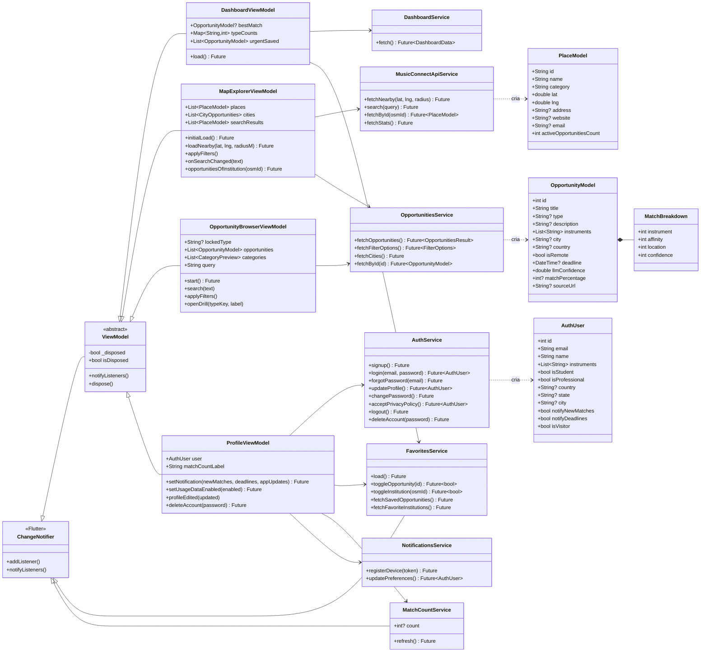

# Diagrama de classes do aplicativo MusiConnect

Complemento da seção [10. Diagrama de classes](../../README.md#10-diagrama-de-classes) do README. O diagrama apresenta as principais classes do aplicativo Flutter, organizadas nas camadas do padrão MVVM, com os atributos e métodos mais relevantes de cada uma.

>**Legenda:** a seta com ponta triangular vazada indica herança; a seta contínua, dependência entre classes (o ViewModel utiliza o serviço); a seta tracejada, que o serviço cria instâncias do modelo a partir das respostas da API; e o losango preenchido, composição (o detalhamento do match faz parte da oportunidade).
