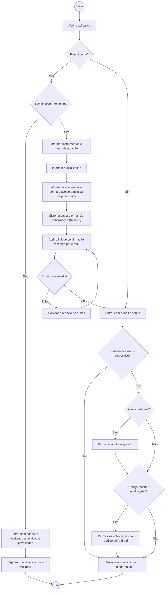
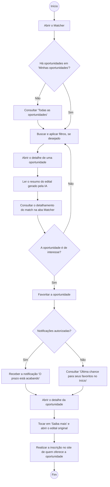
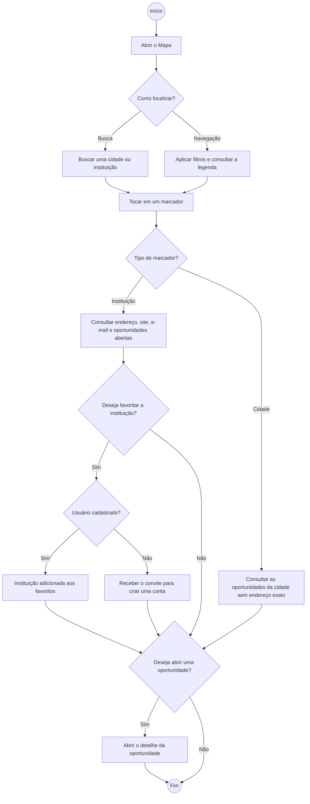

# Diagramas de atividade dos fluxos de uso

Complemento da seção [7. Fluxos de uso](../../README.md#7-fluxos-de-uso) do README. Cada diagrama descreve, passo a passo, um fluxo completo do aplicativo, com as decisões do usuário e do sistema.

## 7.1 Fluxo 1: Cadastro e primeiro acesso

## 7.2 Fluxo 2: Encontrar e acompanhar uma oportunidade compatível

## 7.3 Fluxo 3: Explorar instituições no mapa

