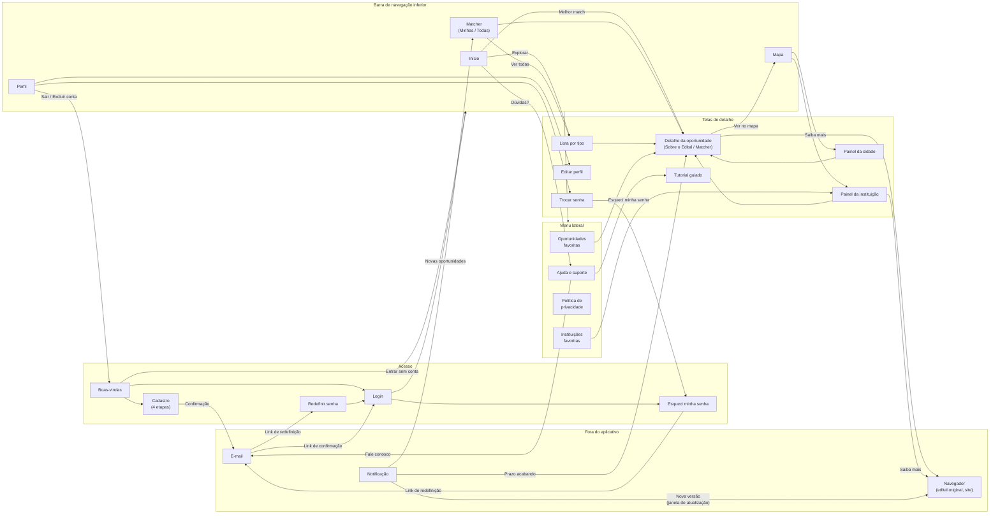

# Mapa de navegação do MusiConnect

Complemento da seção [8.2 Mapa de navegação](../../README.md#8-estrutura-de-navegação) do README. O diagrama mostra todas as telas do aplicativo e como se chega a cada uma; os rótulos das setas indicam o elemento tocado.

No modo visitante, a navegação é a mesma, com três diferenças: a aba Perfil exibe um convite para criar conta ou entrar; as listas de favoritos e a aba "Minhas oportunidades" exibem o mesmo convite; e as ações que dependem de conta, como favoritar, abrem uma janela que encaminha ao cadastro ou ao login.
