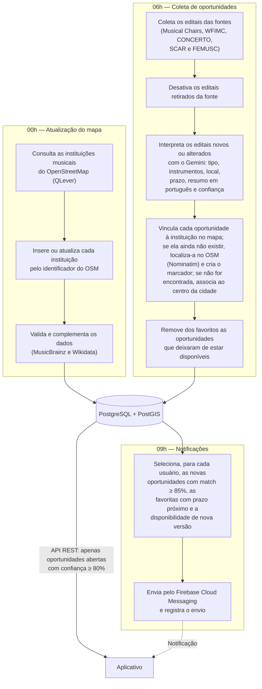

# Pipeline de dados do MusiConnect

Complemento da seção [9.4 Pipeline de dados e fontes](../../README.md#94-pipeline-de-dados-e-fontes) do README. O diagrama detalha as três rotinas diárias executadas pelo agendador da API e o caminho dos dados até o aplicativo.

